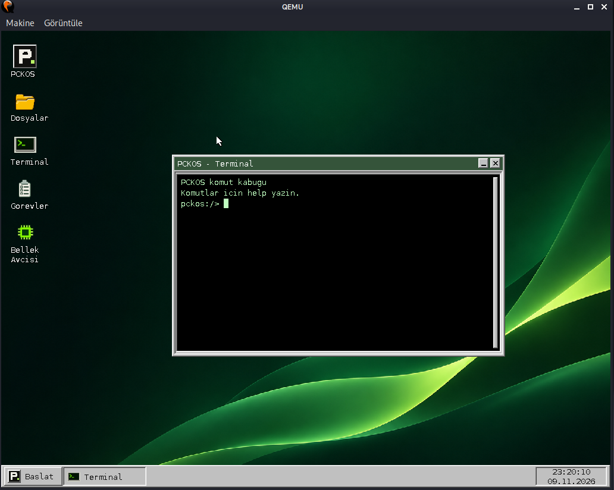
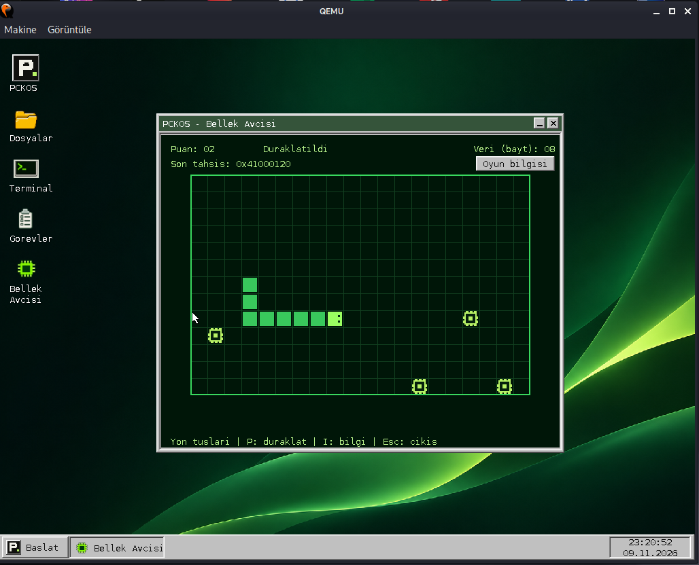
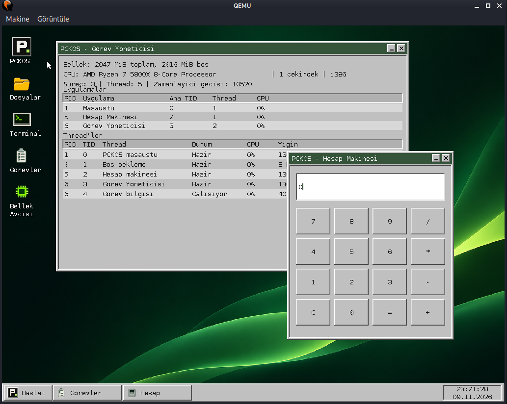
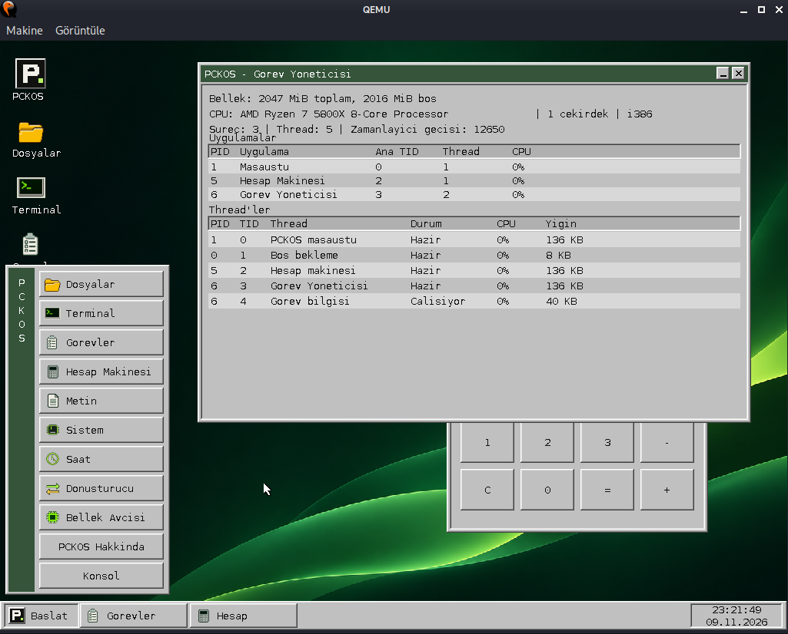
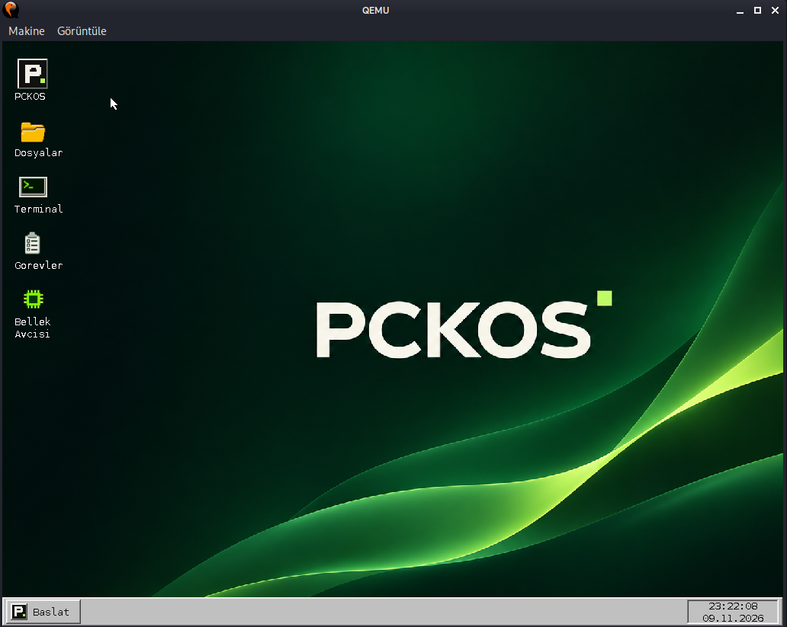

# PCKOS

[Türkçe](README.md) | [English](README.en.md)

**PCKOS** is an operating system kernel project that I started developing from scratch as a hobby, drawing on my experience as a systems programmer.
I began writing my own operating system kernel about seven years ago.
I have never had the opportunity to work on the project full time, and over the past two years I have taken a longer break from development than before.
I have now decided to share PCKOS as an open-source project. My goal is to build a community of people interested in it and continue developing it together. :)

More information: [PCKOS on my blog](https://pckblog.com/pckos.html)

Use the links below to download the latest compiled PCKOS ISO and filesystem image. PCKOS uses its own filesystem, PCKFS, so you also need to download `pckfs.img` alongside the ISO. To run PCKOS in VirtualBox, you can use the ready-made `pckfs-vbox.vdi` image instead of `pckfs.img`.

- **PCKOS ISO:** [pckos.iso](https://raw.githubusercontent.com/alipicakcii/pckos/main/downloads/pckos.iso)
- **PCKFS filesystem image:** [pckfs.img](https://raw.githubusercontent.com/alipicakcii/pckos/main/downloads/pckfs.img)
- **PCKFS image for VirtualBox:** [pckfs-vbox.vdi](https://raw.githubusercontent.com/alipicakcii/pckos/main/downloads/pckfs-vbox.vdi)
- [SHA-256 checksums](https://raw.githubusercontent.com/alipicakcii/pckos/main/downloads/SHA256SUMS)

If the VDI causes problems, see “Run in VirtualBox” for instructions on recreating it.

## Run in QEMU

After downloading `pckos.iso` and `pckfs.img`, place both files in the same directory and start PCKOS with:

```sh
qemu-system-i386 -m 2G \
  -cdrom pckos.iso \
  -drive file=pckfs.img,format=raw,if=ide,index=0,media=disk
```

The ISO boots the kernel; `pckfs.img` provides the PCKOS root filesystem. Both are required. Add, for example, `-smp 4` to the QEMU command to use multiple processors. When building from source, `./run.sh` uses the host's logical processor count, capped at 32. Run `PCKOS_CPUS=4 ./run.sh` to choose a count or `PCKOS_CPUS=1 ./run.sh` for one processor.

## Run in VirtualBox

Download `pckos.iso` and `pckfs-vbox.vdi` using the links above. You can attach the ready-made VDI directly to VirtualBox; no conversion is needed.

If you wish, you can recreate your own VDI by converting `pckfs.img` with this command:

```sh
VBoxManage convertfromraw pckfs.img pckfs-vbox.vdi --format VDI
```

When building the images from source, run these commands in the project directory:

```sh
./iso.sh
./share.sh
./vbox.sh
```

These commands create the ISO and PCKFS disk image; `vbox.sh` converts `pckfs.img` to the `pckfs-vbox.vdi` format used by VirtualBox.

Whichever method you use, create a new **Linux / Other Linux (32-bit)** virtual machine. Choose a memory size that suits your setup. Select **VBoxVGA** as the graphics controller, and turn off 3D acceleration. Do not create a blank hard disk. In Storage, attach `pckos.iso` to the optical drive and `pckfs-vbox.vdi` as the IDE **Primary Master**. Set the boot order to start from the optical drive. The ISO boots the system; the VDI provides its root filesystem.


## Current PCKOS features

PCKOS is currently a minimal system under development. The kernel currently provides:

- i386 boot, paging, and separation between kernel and user mode.
- User applications that access kernel services through system calls.
- ACPI/xAPIC SMP with Round Robin scheduling on up to 32 logical processors, and processes with separate address spaces. Single-processor systems are also supported.
- A framebuffer desktop with keyboard, mouse, windows, and a taskbar.
- Shared user interface APIs for `Window`, `Widget`, `Button`, and `ClickListener`; PNG application icons appear on the desktop, Start menu, and taskbar.
- The PCKFS root filesystem and an IDE ATA PIO disk driver. User applications can currently read files; general file writing is not implemented yet.
- Desktop applications: Terminal, Files, Task Manager, Calculator, and a read-only Notepad.
- RTC date/time; memory, processor, and thread information in Task Manager.

## Contributing and reporting issues

I am not opposed to using AI. Contributions to the project may use AI tools; my only expectation is that contributors understand and can explain the changes they submit.

## Screenshots

### Terminal



### Memory Hunter



In Memory Hunter, each time food is eaten, the game allocates one `uint32_t` (4 bytes) from the user heap. The window shows the allocation address and the total size of game data allocated. The last allocation address is the starting address of the most recently allocated 4-byte block. The allocations are released with `delete` when the game closes. A real memory hunter! 🙂

### Task Manager and Calculator



### Start Menu



### Desktop



## Development environment

I develop PCKOS on Kali Linux. I compile C++ with a GNU `i686-elf-g++` cross-compiler built from GCC 13.1.0 sources, and assembly with NASM 3.01. Kali Linux is the development host; PCKOS targets i386.

# Technical documentation

This document describes the **currently working code**. When adding a feature, start with the “Source map” table; later sections cover boot, PCKFS, system calls, processes/threads, and a new-application example. Run commands from the project root.

## 1. Boot: from the first instruction to the desktop

```text
QEMU/BIOS → GRUB → Multiboot _start → kernel_main
          → GDT/IDT + memory + drivers + PCKFS + PIT
          → user address space → Ring 3 desktop
          → separate application processes from PCKFS
```

1. `./run.sh` attaches `pckos.iso` as a CD-ROM and `pckfs.img` as an IDE disk. `iso.sh` writes `isodir/boot/grub/grub.cfg`, which tells GRUB to load `pckos.bin` in 1024×768×32 graphics mode.
2. GRUB reads the Multiboot header in `kernel/arch/i386/boot.asm`. `_start` sets up the first 16 KiB kernel stack and passes the Multiboot info address to `kernel_main()`. `kernel/arch/i386/linker.ld` links the kernel at 1 MiB.
3. `kernel/kernel.cpp` disables interrupts, initializes the processor tables, and starts paging. After the kernel heap is ready, `_init()` runs global C++ constructors.
4. The keyboard, mouse, framebuffer, ATA PIO disk, and PCKFS are initialized. `_kprintf` writes boot messages to the kernel console log. The PIT is set to 100 Hz. Once the framebuffer is ready, the boot log is displayed on screen: CPU vendor/model, Multiboot information, GDT/IDT/TSS, CR3, physical page counts, display dimensions, disk/PCKFS status, and RTC date/time. Syscall, user heap/stack, and scheduler information is shown before entering the desktop. Press ESC on the desktop to see the system console with boot messages and subsequent kernel output. `dmesg` also reads the log.
5. `kernel/task/user_mode.cpp` prepares user pages, the user stack, and system calls; `kernel/task/thread.cpp` initializes scheduling. On SMP systems, INIT/SIPI starts additional processors and prepares per-CPU GDT/TSS and scheduler state. `user_mode_run_desktop()` loads the desktop image at `0x40000000`. `iret` in `kernel/arch/i386/user_mode.asm` enters Ring 3.
6. The desktop starts at `_start` in `kernel/user/apps/desktop.cpp`. Opening Files, Terminal, Tasks, Calculator, or Notepad calls `process_spawn()`. The kernel loads `/apps/*.bin` from PCKFS and creates a PID, address space, and main thread.

### Loading the desktop and applications

The desktop program is included in the kernel image by the `incbin` directive in `kernel/arch/i386/user_desktop.asm` and loaded into memory during startup. Other applications are not included in the kernel; when launched, they are loaded from `/apps/*.bin` on the PCKFS disk. Both run in Ring 3; drivers and system-call handlers run in Ring 0.

## 2. Source map

| Path | Purpose |
| --- | --- |
| `kernel/arch/i386/` | Multiboot entry, GDT/IDT, interrupts, Ring 3 transition, linker scripts |
| `kernel/kernel.cpp` | Kernel initialization order |
| `kernel/core/`, `kernel/include/kernel/core/` | Panic display and kernel error reporting |
| `kernel/include/kernel/task/`, `kernel/include/kernel/syscalls/` | Kernel task management and syscall interfaces |
| `kernel/include/firmware/smp.hh` | i386 SMP interface |
| `kernel/mem/` | Paging, physical memory, kernel heap |
| `kernel/interrupts/`, `kernel/task/thread.cpp` | IRQ/PIT, Round Robin scheduling, PID/TID tables |
| `kernel/arch/i386/firmware/` | ACPI CPU discovery, APIC, AP startup, kernel lock, and TLB IPIs |
| `kernel/device/ata_pio.cpp` | Sector access to the IDE disk |
| `kernel/device/rtc.cpp` | Date and time from the CMOS RTC |
| `kernel/fs/pckfs.cpp` | PCKFS mount, path lookup, directory and file reads |
| `kernel/task/user_mode.cpp` | User address spaces, program loading, process and user-thread creation |
| `kernel/syscalls/syscall.cpp` | `int 0x80` entry checks and call routing |
| `kernel/syscalls/` | Handlers grouped by subsystem, including user-memory validation |
| `kernel/include/user/syscall/call.hh` | User-side `int 0x80` entry helper |
| `kernel/include/abi/` | Fixed syscall numbers and data structures shared by kernel and user space |
| `kernel/include/user/fs/` | File and directory API |
| `kernel/include/user/task/` | Process and thread APIs |
| `kernel/include/user/gui/` | Graphics calls, drawing, and window dragging helpers |
| `kernel/include/user/memory/`, `kernel/include/user/io/` | Heap and standard stream APIs |
| `kernel/include/user/input/`, `kernel/include/user/device/`, `kernel/include/user/system/` | Input events, audio, and system information |
| `kernel/include/user/lib/` | General memory/string routines, random numbers, and template helpers |
| `kernel/include/user/gui/drawing.hh`, `kernel/user/gui/graphics.cpp` | Shared Ring 3 drawing API |
| `kernel/include/user/gui/window.hh`, `kernel/user/gui/window.cpp` | Application window, title bar, dragging, minimize, and close |
| `kernel/include/user/gui/widgets.hh`, `kernel/user/gui/widgets.cpp` | Reusable widgets, buttons, and `ClickListener` |
| `kernel/device/video/frame_buffer.cpp` | Framebuffer and window-layer composition |
| `kernel/user/apps/desktop.cpp` | Desktop, icons, Start menu, taskbar, application launch |
| `kernel/user/apps/*_process.cpp` | Application `_start` and event loop |
| `kernel/user/apps/terminal.cpp`, `file_manager.cpp`, `task_manager.cpp` | Application behavior |
| `assets/app-icons/` | Source PNG application icons copied by `share.sh` into `/system/icons/` on PCKFS |
| `tools/mkpckfs.py`, `host-share/` | Disk-image generation and optional host files |

When the kernel heap grows, new pages are first mapped in the master kernel page directory (`KERN_PAGE_DIRECTORY`). `Vmm::sync_all_from_kernel()` propagates these mappings to active user processes. A `[PageFault]` entry in the kernel console log reports the faulting address (`CR2`), instruction pointer (`EIP`), error code, and active page directory (`CR3`).

## 3. Build and run

Required tools: `i686-elf-g++`, `i686-elf-objcopy`, `nasm`, `make`, `grub-mkrescue`, `python3`, and `qemu-system-i386`. Shared configuration is in `config.sh` and `kernel/Makefile`.

| Command | Result |
| --- | --- |
| `./build.sh` | Builds the kernel/apps and installs the kernel under `sysroot/boot/`. |
| `./iso.sh` | Runs `build.sh` and creates `pckos.iso`. |
| `./share.sh` | Runs `build.sh`; creates `pckfs.img` from `host-share/`, system apps, and the logo. |
| `./run.sh` | Cleans, rebuilds the ISO and disk, and starts QEMU. |
| `./vbox.sh` | Converts the current `pckfs.img` to `pckfs-vbox.vdi`. Build a fresh image first. |
| `./clean.sh` | Removes build and image outputs; preserves `host-share/`. |

`sysroot/` and `isodir/` are staging directories only. The running system's root is `/` inside `pckfs.img`; there is no initrd. `.elf` is a linker output; the loader receives a flat `.bin` image produced by `objcopy`. `run.sh` uses KVM when available and TCG otherwise. The serial port is disabled. View kernel output in the ESC console or with `dmesg`.

`vbox.sh` removes the previous `pckfs-vbox.vdi` and recreates it with `convertfromraw`. It uses a fixed disk UUID registered with the VM so VirtualBox's disk registration remains stable. It does not change the ISO, kernel, or VM settings. Shut down the VirtualBox VM before regenerating the disk.

## 4. PCKFS v1: a brief technical description

`tools/mkpckfs.py` creates a 32 MiB raw disk image by default. `share.sh` copies `host-share/` into `sysroot/pckfs-source/`, adds compiled applications under `/apps/`, and copies PNG files from `assets/app-icons/` to `/system/icons/`. `assets/logo.bmp` is copied to `/system/logo.bmp`. Default directories are `/boot`, `/dev`, `/etc`, `/home`, `/mnt`, `/tmp`, and `/var`; `/apps` contains system applications. These are named directories only; for example, `/dev` has no Unix device-node semantics.

Physical disk layout:

```text
LBA 0: superblock (512 bytes, magic "PCKFS1\0\0", version 1)
LBA 1...: inode table (256 records × 64 bytes)
then: block-chain table (32-bit next-block index per data block)
then: data area (4096 bytes per block = 8 sectors)
```

The superblock stores sector count, inode/FAT/data starts, and root inode. Each inode stores a 48-byte name, file size, first data block, parent inode, type, and used flag. Type `1` is a file and `2` a directory; root inode is `0`. `0xFFFFFFFF` marks the end of a FAT-like chain. Data block numbering starts at **1**; block 1 starts at `data_start_sector`. Directories have no content blocks; children are found by comparing the inode `parent` field. Names are limited to 47 UTF-8 bytes. Symbolic links are not supported.

At boot, `AtaPioDisk::initialize()` detects the IDE disk. `pckfs_mount()` validates the superblock, sizes, inodes, and FAT. `pckfs_find()` resolves `/a/b`; `pckfs_get_child()` lists directory children; `pckfs_read_file_range()` follows the block chain and reads sectors. The image builder is `tools/mkpckfs.py`, the reader is `kernel/fs/pckfs.cpp`, and user-facing file handlers are in `kernel/syscalls/filesystem.cpp`. **Update all three together when changing the disk format.** Update version/layout validation too, so older images are rejected when incompatible.

PCKFS v1 is currently **read-only** to user applications. The ATA driver has a sector-write function, but PCKFS does not yet provide generic create/write/delete operations or syscalls. To add a host file:

```sh
mkdir -p host-share/home/pck
cp example.txt host-share/home/pck/example.txt
./run.sh
```

The file appears at `/home/pck/example.txt` in PCKOS. It is visible in Files and can be read in Terminal with `cat /home/pck/example.txt`. `run.sh` recreates the disk each time, so keep host files in `host-share/`.

Read a file from a user application:

```cpp
#include <user/fs/filesystem.hh>
#include <user/io/stream.hh>

char buffer[128];
const int32_t fd = user::open("/home/pck/example.txt"); // flags=0, read-only
if (fd >= 0) {
    const int32_t count = user::read(fd, buffer, sizeof(buffer));
    if (count > 0)
        user::write(user::stdout_descriptor, buffer,
                    static_cast<uint32_t>(count));
    user::close(fd);
}
```

`stdout` and `stderr` from applications started with `run` go to the calling terminal; see below. Use `root_inode()` and `read_directory(inode, index, &entry)` for directories: return values are `1` for an entry, `0` for end of list, and a negative error otherwise. `DirectoryEntry::type == user::directory_type` identifies a directory.

## 5. SDK and system calls

The user API is grouped by subsystem under `kernel/include/user/`:

| Header | Purpose |
| --- | --- |
| `user/task/thread.hh` | Thread creation, sleep, and thread information |
| `user/task/process.hh` | Process launch, exit, and window focus |
| `user/fs/filesystem.hh` | File reading and directory listing |
| `user/io/stream.hh` | Standard streams and terminal connections |
| `user/input/events.hh` | Keyboard and mouse events |
| `user/gui/graphics.hh` | Low-level drawing and window calls |
| `user/memory/heap.hh` | User memory allocation and release |
| `user/system/info.hh` | System information, time, and the kernel log |
| `user/device/audio.hh` | PC speaker |

`user/syscall/call.hh` provides only the `int 0x80` entry helper and access to syscall numbers. Shared data structures such as `ThreadInfo` are defined once under `kernel/include/abi/` and used by the corresponding kernel and user headers.

Graphics helpers are in `kernel/include/user/gui/drawing.hh` and `kernel/user/gui/graphics.cpp`. The shared window and widget API is declared under `kernel/include/user/gui/` and implemented in `kernel/user/gui/window.cpp` and `widgets.cpp`. `Window` handles registration, its frame, title-bar controls, dragging, minimizing, and closing. `Button`, `Label`, and `TextInputWidget` attach to their parent window when constructed. `Window::draw()` draws attached widgets inside the client area, and `Window::handle_mouse()` routes clicks to them. `Button` calls its `ClickListener`; `TextInputWidget` places the text cursor at the clicked position. The Makefile links these library sources into user applications. `kernel/include/user/lib/memory.hh` provides basic memory/string routines, and `kernel/include/user/memory/new.hh` provides `new`/`delete` backed by the user heap. This is a small starter runtime, not a full C/C++ standard library or STL.

### Window and button widgets

Each application creates a `Window` object. The window API handles registration, title bar drawing, dragging, minimizing, and closing. Place application content using `content_x()`, `content_y()`, `content_width()`, and `content_height()`. Widgets attached to a window use coordinates relative to its client area. Call `Window::draw()` each frame to draw the window and its attached widgets. Pass mouse events to `Window::handle_mouse()`; it handles title-bar controls and routes clicks to attached widgets.

`ClickListener` takes a callback and a context pointer instead of a capturing C++ lambda. The context lets the callback access application state:

```cpp
#include <user/gui/widgets.hh>
#include <user/gui/window.hh>

void on_button_click(void *context, uint32_t id)
{
    auto *click_count = static_cast<uint32_t *>(context);
    if (id == 1)
        ++*click_count;
}

uint32_t clicks = 0;
user::gui::Window window(120, 90, 420, 280, "PCKOS - Example");
user::gui::ClickListener listener(on_button_click, &clicks);
user::gui::Button button(window, 1, 16, 16, 140, 36, "Click", &listener);

user::gui::begin_frame();
window.draw();
user::gui::end_frame();

window.handle_mouse(mouse_x, mouse_y, mouse_buttons, pressed,
                    screen_width, usable_height);
```

The coordinates in the `Button` constructor are relative to the window's client area. Calculator and Unit Converter use the shared window/button API; other windowed applications use `Window` for their frame, movement, and title-bar controls.

### Standard input, output, and error streams

`run /apps/newapp.bin` starts a separate process and passes on the terminal connection. `stdin` (0) receives terminal input; `stdout` (1) carries normal output and `stderr` (2) carries errors. Both output streams appear in the same terminal in syscall order; attached application output is not added to the kernel log. Child processes inherit the terminal connection. Output from applications without a terminal connection goes to the system console log. Nothing is written to the serial port.

The terminal waits for the process started by `run` before accepting another shell command. Lines submitted with Enter go to the application's `stdin` queue. Ctrl+D on empty input sends EOF; if text has been entered, it sends that text first. The `pckos:/>` prompt returns when the process ends. A graphical application takes focus when it registers its window. Minimized terminals continue collecting output.

Use `cd /apps`, `cd ..`, and `cd -` to change directories, and `pwd` to display the current directory. `ls`, `cat`, and `run` also accept relative paths; for example, use `run demo.bin` from `/apps`. The working directory belongs to the terminal. Additional commands include `ps`, `date`, `uptime`, and `history`; `help` groups commands by purpose. Ctrl+L clears the screen, Up/Down recall commands, and PgUp/PgDn or the scrollbar show earlier output.

Ctrl+C terminates the application launched with `run` and its descendants attached to the same terminal, reclaiming their memory, threads, windows, and open files. This is not a POSIX signal and does not invoke user object destructors. With no application running, it cancels the current command line. `terminal_interrupt(pid)` (50) permits only a terminal owner to terminate applications attached to its own terminal.


```cpp
#include <user/io/stream.hh>
#include <user/task/process.hh>
#include <user/io/io.hh>

extern "C" [[noreturn]] __attribute__((section(".text._start"))) void _start()
{
    print("Hello %s! Value: %d\n", "PCKOS", 42);
    eprint("Example error code: %d\n", -1);
    print("Type a line and press Enter:\n");
    char input[128];
    const int32_t count = user::io::read(input, sizeof(input));
    if (count > 0)
        user::io::write_all(user::stdout_descriptor, input, count);
    user::exit(count < 0 ? 1 : 0);
}
```

Include `<user/io/io.hh>` to use `print("Value: %d\n", value)` directly. `print` writes to stdout, `eprint` to stderr, and `fprint(fd, format, ...)` chooses either descriptor. These functions are also available in `user::io`. They return the number of bytes written or a negative error. The implementation is `kernel/user/io/io.cpp`; link `kernel/user/io/io.user.o` when building an application manually. The project Makefile links it automatically.

Supported formats: `%s`, `%c`, `%d`, `%i`, `%u`, `%x`, `%X`, `%o`, `%p`, and `%%`; field width, `-`, `0`, `+`, space and `#` flags; precision such as `%.3s` or `%08x`; `*` width/precision; and `h`, `hh`, `l`, `z` integer modifiers. Width and precision are limited to 4096. Floating-point formats, `ll`, and `%n` are not supported; unsupported formats return `-22`. Use `print("%s", text)` for text containing literal percent signs.

`user::io::write_all` writes raw bytes, and `user::io::read` sleeps the thread until input is available, returning `0` for EOF or a negative error. The library remains minimal; it is not full libc or iostream.

The desktop follows new kernel messages with `read_kernel_log(buffer, capacity, &cursor)` (syscall 47). Start the cursor at zero and preserve it across calls. The kernel log is a 4096-byte ring; if the reader falls behind, it resumes at the oldest remaining byte. The ESC console displays new messages without repeatedly appending the same snapshot.

Low-level `user::write(fd, buffer, length)` accepts at most 4096 bytes per call. The terminal's shared output queue holds 8192 bytes; writes may be short, or return `-11` (EAGAIN) when full. `write_all` retries these cases. If the terminal has closed, writes return `-32` (EPIPE); no signal is raised. Each process has a 512-byte input queue. An empty attached `stdin` returns `-11` from `user::read`, and EOF returns `0`. Output lines continue across separate `write` calls; ANSI escape sequences are not interpreted yet.

For terminal frontends, `terminal_attach()` (44) makes the caller a terminal owner; `terminal_read(buffer, length)` (45) drains pending output; `terminal_send(pid, buffer, length)` (46) sends input only to processes attached to that terminal. Zero length signals EOF. Normal applications use `read`/`write` or the `user::io` helpers instead. File redirection (`>`), pipes (`|`), `dup2`, signals, and full job control are not implemented yet.

`user::call()` invokes `int 0x80`. `EAX` contains the syscall number; `EBX/ECX/EDX/ESI/EDI` carry up to five arguments; the result is returned in `EAX`. `kernel/syscalls/syscall.cpp` routes calls to the appropriate handler under `kernel/syscalls/`, which validates user pointers and lengths. Errors are negative values. Prefer wrapper functions to hard-coded syscall numbers.

| Area | Main APIs |
| --- | --- |
| Files | `open`, `read`, `close`, `root_inode`, `read_directory` |
| Logging/input | `read`, `write`, `<user/io/io.hh>`, `terminal_attach`, `terminal_read`, `terminal_send`, `get_kernel_log`, `read_kernel_log`, `wait_event` |
| Processes | `process_spawn`, `process_count`, `process_get_info`, `process_focus`, `process_minimize`, `exit` |
| Threads | `thread_create`, `thread_id`, `thread_sleep`, `thread_yield`, `thread_exit`, `thread_get_info` |
| Memory | `heap_alloc`, `heap_free`, `new`/`delete` via `<user/memory/new.hh>`, `memcpy`, `memmove`, `memset`, `memcmp`, `strlen`, `strcmp`, `strncmp`, `strcpy`, `strncpy` via `<user/lib/memory.hh>` |
| System | `get_ticks`, `get_datetime`, `get_heap_usage`, `get_system_info` |
| Graphics | `graphics_get_info`, `graphics_register_window`, `graphics_begin_frame`, `graphics_end_frame`, `graphics_rect`, `graphics_text`, `graphics_bitmap`, `graphics_push_clip`, `graphics_pop_clip` |

`wait_event(&event, ticks)`: `type=1` is keyboard (`value0` character), `type=2` is mouse (`value0` X delta, `value1` Y delta), and `type=3` is timeout. `buttons & 1` means left button; `buttons & 0x100` marks a new press edge. 100 PIT ticks are approximately one second. Drawing uses screen coordinates. A windowed app creates a `Window`, draws each frame between `user::gui::begin_frame()` and `end_frame()`, and calls `Window::draw()`. Route mouse events through `Window::handle_mouse()`. Low-level helpers include `fill`, `text`, `button`, `icon`, and `push_clip`.

`get_datetime(&date)` fills `user::DateTime` from the RTC. The taskbar clock displays the VM's RTC time, not elapsed uptime; QEMU sets the RTC to host local time. Calculator and Notepad launch from the Start menu and each get a separate PID and main thread. Calculator supports integer `+`, `-`, `*`, and `/`. Notepad displays the first 8191 bytes of any PCKFS text file as **read-only**. For example, `host-share/home/notlar.txt` appears at `/home/notlar.txt`; the file name has no special meaning in code.

```cpp
user::InputEvent event{};
if (user::wait_event(&event, 10) > 0 &&
    event.type == 1 && event.value0 == 0x1B)
    user::exit(0); // ESC
```

To add a syscall, add its number to `kernel/include/abi/syscall.hh` and its user wrapper to the appropriate header under `kernel/include/user/`. Add the handler in the relevant `kernel/syscalls/` source file and route the call in `kernel/syscalls/syscall.cpp`. Validate user-provided addresses with `is_user_range`. Implement kernel functionality in the relevant module under `kernel/`. Document return values and limits here.

**Memory and basic helpers in user applications**

The `kernel/include/user/lib/memory.hh` header provides `memcpy`, `memmove`, `memset`, `memcmp`, `strlen`, `strcmp`, `strncmp`, `strcpy`, and `strncpy`. You can also call these through `user::memory::copy`, `move`, `fill`, `compare`, `length`, and `equal`. Link `kernel/user/lib/memory.user.o` into the application.

The `kernel/include/user/memory/new.hh` header and `kernel/user/memory/new.cpp` provide user-space `new`, `new[]`, `delete`, `delete[]`, placement new, and C++17 aligned allocation. Link `kernel/user/memory/new.user.o` into the application. The existing Makefile links all three runtime objects automatically for built-in apps. The kernel's `kernel/mem/new.cpp` continues to use its own heap.

Example:

```cpp
#include <user/lib/memory.hh>

char text[16];
user::memory::fill(text, 0, sizeof(text));
user::memory::copy(text, "PCKOS", 6);
const bool matches = user::memory::equal(text, "PCKOS");
```

```cpp
#include <user/memory/new.hh>

int *value = new int(42);
delete value;

int *numbers = new (std::nothrow) int[100];
if (numbers != nullptr) {
    numbers[0] = 7;
    delete[] numbers;
}
```

Each process has a heap of up to 32 MiB at `0x41000000–0x43000000`; physical pages are allocated on demand. Threads in the same process share this heap, while different processes have separate page mappings. Up to 1024 allocations can be live at once. Default alignment is 16 bytes; power-of-two alignments up to 1 MiB are accepted. Small allocations share pages; freeing the last allocation on a page releases that physical page. Process exit also reclaims allocations that were not deleted.

`heap_alloc(size, alignment)` (syscall 42) returns raw memory or `nullptr` on failure; `heap_free(address)` (syscall 43) releases it. Allocation records are stored in the kernel; only a valid allocation start in the calling process can be freed. A shared kernel lock protects allocation records. Page mapping changes send TLB invalidation IPIs to the other processors. If normal `new` cannot allocate memory, it logs an error and terminates the calling process with status `-12`, since exceptions are disabled. Use `new (std::nothrow)` to handle failure in the application. `get_heap_usage()` still reports kernel heap usage.


## 6. Creating a process

A **process** is a program with its own PID and page table/address space. The kernel starts the desktop process at boot; other processes are created only when launched. From a user program:

```cpp
const int32_t pid = user::process_spawn("/apps/terminal.bin", "Terminal");
if (pid < 0) {
    const char message[] = "Launch failed\n";
    user::write(user::stderr_descriptor, message, sizeof(message) - 1);
}
```

On success, `process_spawn` returns the new PID and does not wait for the application. The kernel copies the user path/name in `kernel/syscalls/process.cpp`; `user_mode_spawn_process()` reads the flat binary from PCKFS, allocates an address space and code/stack pages, `process_create()` assigns a PID, and `thread_create_user()` creates the main TID. The app starts at `_start`; `user::exit(status)` or exit of its main thread terminates the process. Its resources and window layer are then released.

List processes with `process_count()` and `process_get_info()`. `process_focus(pid)` raises one; `process_minimize()` minimizes the caller. The desktop tracks one PID per application type, so clicking an already-open app raises its existing window.

## 7. Creating a thread

A **thread** shares its process PID and address space, but gets its own TID, user stack, and kernel interrupt stack. The Round Robin scheduler distributes ready user threads across online processors; threads in the same process can execute in parallel on different processors. The BSP uses the PIT for the 100 Hz system clock, while additional processors use local APIC timers at approximately 100 Hz. With one processor, threads take turns.

```cpp
#include <user/task/thread.hh>

void worker(void *argument)
{
    volatile uint32_t *counter =
        static_cast<volatile uint32_t *>(argument);
    for (;;) {
        ++*counter;
        user::thread_sleep(100); // about one second
    }
}

volatile uint32_t counter = 0;
const int32_t tid = user::thread_create(worker, (void *)&counter, "Counter");
if (tid < 0) {
    // Thread creation failed.
}
```

`thread_create` returns a TID on success. The kernel allocates a thread slot and user stack, then places the entry point and argument on the stack. `thread_start_trampoline` calls `thread_exit` when the function returns. A working example is `TaskManager::thread_entry` in `kernel/user/apps/task_manager_process.cpp`, where a worker gathers information while the main thread draws the window. See `SpinLock`/`LockGuard` in `kernel/include/user/apps/app_thread.hh` for shared data. Generic `join`, mutex, and semaphore APIs are not available yet. Other threads are cleaned up when the main thread/process exits.

SMP sources are under `kernel/arch/i386/firmware/`: `topology.cpp` reads the ACPI MADT, `trampoline.asm` brings an additional processor from real mode into protected mode and enables paging, and `smp.cpp` manages APIC, INIT/SIPI, TLB notifications, and the kernel lock. Each processor has its own GDT, TSS, kernel stack, and current-thread record. The bootstrap desktop main thread stays on the BSP; other user threads can migrate between processors.

This initial SMP implementation serializes kernel services with a shared lock. User code runs in parallel; drawing frames are serialized between `begin_frame` and `end_frame` to protect shared graphics state. Other processors briefly pause during process memory teardown, and terminated threads are no longer scheduled. Use `SpinLock`/`LockGuard` or atomic operations for shared user data; `volatile` alone does not provide synchronization.

Limits: 32 logical processors, 64 threads including idle threads, and 8 processes. Startup currently uses ACPI RSDT/MADT and xAPIC; x2APIC is not supported. If an additional processor fails to start, the system continues with the online processors. Without SMP information, it uses the single-processor path. Task Manager reports online logical processors and calculates CPU percentages against total processor capacity.

## 8. Writing, building, and launching an application

Example file: `kernel/user/apps/newapp_process.cpp`. The entry point for a flat binary loaded by PCKOS must be `_start`:

```cpp
#include <user/gui/graphics.hh>
#include <user/input/events.hh>
#include <user/task/process.hh>
#include <user/task/thread.hh>
#include <user/gui/drawing.hh>
#include <user/gui/window.hh>

extern "C" [[noreturn]]
__attribute__((section(".text._start"))) void _start()
{
    constexpr uint32_t width = 360;
    constexpr uint32_t height = 180;
    user::GraphicsInfo screen{};
    if (user::graphics_get_info(&screen) < 0 ||
        screen.width < 400 || screen.height < 300)
        user::exit(1);

    const uint32_t usable_height = screen.height - 48;
    user::gui::Window window((screen.width - width) / 2,
                             (usable_height - height) / 2,
                             width, height, "PCKOS - NewApp");
    if (!window.valid())
        user::exit(1);
    user::thread_set_name("NewApp");

    int32_t mouse_x = static_cast<int32_t>(screen.width / 2);
    int32_t mouse_y = static_cast<int32_t>(screen.height / 2);
    (void)user::graphics_get_cursor(&mouse_x, &mouse_y);
    user::graphics_cursor(mouse_x, mouse_y, true);
    uint32_t last_buttons = 0;

    for (;;) {
        if (user::process_is_minimized()) {
            last_buttons = 0;
            user::InputEvent ignored{};
            (void)user::wait_event(&ignored, 10);
            continue;
        }

        user::gui::begin_frame();
        window.draw();
        user::gui::text(window.content_x() + 16, window.content_y() + 24,
                        "Merhaba PCKOS!", user::gui::COLOR_TEXT);
        user::gui::end_frame();

        user::InputEvent event{};
        if (user::wait_event(&event, 10) <= 0 || event.type == 3)
            continue;
        if (event.type == 1) {
            if (event.value0 == 0x1B)
                user::exit(0);
        } else if (event.type == 2) {
            int32_t cursor_x = mouse_x;
            int32_t cursor_y = mouse_y;
            if (user::graphics_get_cursor(&cursor_x, &cursor_y) == 0) {
                mouse_x = cursor_x;
                mouse_y = cursor_y;
            }
            mouse_x += event.value0;
            mouse_y -= event.value1;
            if (mouse_x < 0) mouse_x = 0;
            if (mouse_y < 0) mouse_y = 0;
            if (mouse_x >= static_cast<int32_t>(screen.width))
                mouse_x = static_cast<int32_t>(screen.width) - 1;
            if (mouse_y >= static_cast<int32_t>(screen.height))
                mouse_y = static_cast<int32_t>(screen.height) - 1;
            user::graphics_cursor(mouse_x, mouse_y, true);

            const bool pressed = (event.buttons & 1U) != 0 &&
                ((last_buttons & 1U) == 0 || (event.buttons & 0x100U) != 0);
            (void)window.handle_mouse(mouse_x, mouse_y, event.buttons, pressed,
                                      screen.width, usable_height);
            last_buttons = event.buttons;
        }
    }
}
```

Save the example above as `kernel/user/apps/newapp_process.cpp`. The following steps compile the new app and run it in PCKOS. Run all terminal commands from the project root, where `build.sh` is located.

This example builds the app manually. The existing Makefile builds only the applications registered in it; creating a new `.cpp` file does not automatically add it to the build. Follow the steps below in order.

**1. Prepare the graphics and memory helpers.**

```sh
./build.sh
```

This builds the existing kernel and registered applications. It also produces `kernel/user/gui/graphics.user.o`, `kernel/user/gui/window.user.o`, `kernel/user/gui/widgets.user.o`, `kernel/user/memory/new.user.o`, `kernel/user/lib/memory.user.o`, and `kernel/user/io/io.user.o`, which our example links. It does not yet compile our new `newapp_process.cpp`; we will do that in the next step.

**2. Compile the application's C++ source.**

```sh
i686-elf-g++ -m32 -ffreestanding -Wall -Wextra -fno-exceptions -fno-rtti \
  -fno-use-cxa-atexit -fno-pic -fno-pie -fno-stack-protector -fno-builtin \
  -fno-unwind-tables -fno-asynchronous-unwind-tables -mno-sse -mno-mmx \
  -msoft-float -Ikernel/include \
  -c kernel/user/apps/newapp_process.cpp -o kernel/user/apps/newapp_process.user.o
```

The input is your `newapp_process.cpp` file. The `-c` option compiles it into the `newapp_process.user.o` object file without linking. This file cannot run on its own yet; it needs to be linked with the graphics functions it uses. `-Ikernel/include` specifies the location of the SDK headers. The other flags are the current build settings for PCKOS user applications.

**3. Link the object file with the graphics library.**

```sh
i686-elf-g++ -m32 -no-pie -nostdlib \
  -Wl,-T,kernel/user/apps/linker.ld -Wl,--build-id=none \
  -o kernel/user/apps/newapp_process.elf \
  kernel/user/memory/new.user.o kernel/user/lib/memory.user.o kernel/user/io/io.user.o \
  kernel/user/gui/window.user.o kernel/user/gui/widgets.user.o \
  kernel/user/gui/graphics.user.o kernel/user/apps/newapp_process.user.o
```

This links your app with the graphics, memory, and `new`/`delete` runtime objects. `linker.ld` defines the application's memory layout and `_start` entry point. The result is `newapp_process.elf`. This ELF file is a linker intermediate; the current PCKOS loader expects a flat binary.

**4. Convert the ELF file into the format PCKOS loads.**

```sh
i686-elf-objcopy -O binary kernel/user/apps/newapp_process.elf \
  host-share/apps/newapp.bin
```

`objcopy -O binary` converts the loadable contents of the ELF into a flat binary. The result is `host-share/apps/newapp.bin`. `host-share` is the host directory used to transfer files into PCKFS. The `host-share/apps` directory is already included in the project.

**5. Package the app in the PCKFS disk image.**

```sh
./share.sh
```

`share.sh` first calls `build.sh`, then rebuilds `pckfs.img` using the contents of `host-share` and the built-in applications. It takes your manually compiled `newapp.bin` as it is; it does not recompile its source. The host file `host-share/apps/newapp.bin` appears inside PCKOS at `/apps/newapp.bin`.

The application is now compiled and included in the disk image. **It does not need to be linked into the kernel.**

**6. Launch the app for an initial trial.**

Run `./run.sh` from the project root. It performs a clean build, regenerates the ISO and PCKFS images, and starts QEMU. Cleanup preserves `host-share/apps/newapp.bin`, which is included in the new disk image.

Open Terminal on the desktop and enter this in the **PCKOS terminal**:

```text
run /apps/newapp.bin
```

The terminal starts a new process from this file. You do not need to edit `desktop.cpp` to launch the app. To launch it from another application, use `user::process_spawn("/apps/newapp.bin", "NewApp")`.

**After changing the application's source:** Repeat steps 2, 3, and 4 to update `host-share/apps/newapp.bin`. Then try it with `./run.sh`, which also performs the packaging in step 5. To refresh only the disk image, run `./share.sh`. If cleanup has removed `graphics.user.o`, or if you changed the graphics library, repeat step 1 first.
