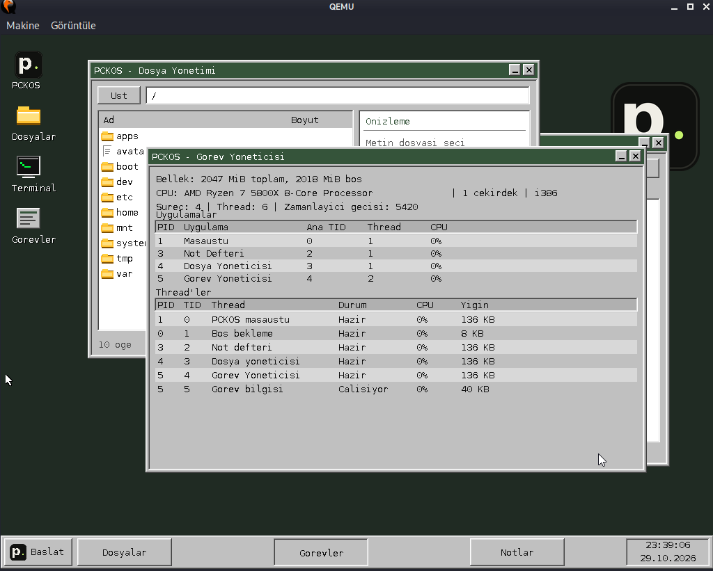
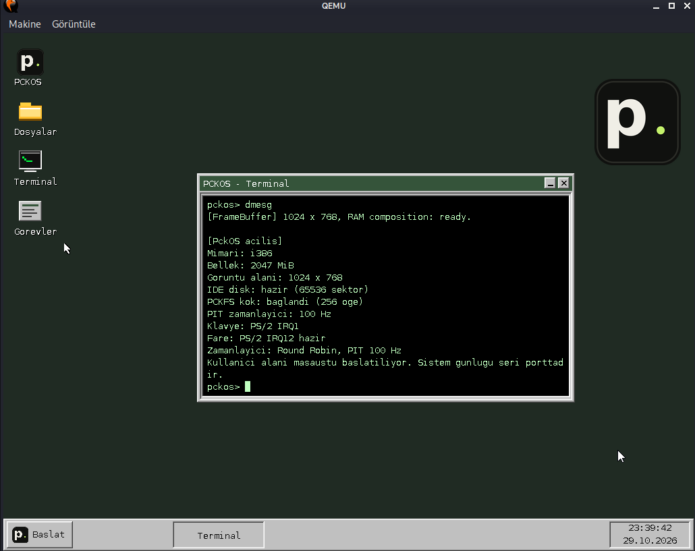
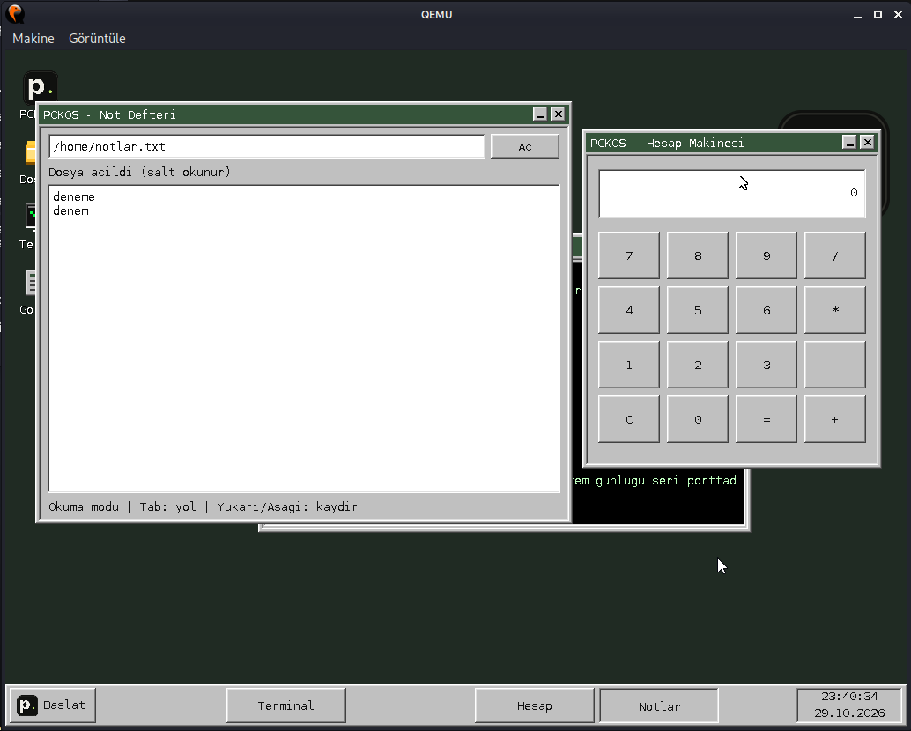

# PCKOS

[Türkçe](README.md) | [English](README.en.md)

**PCKOS** is an operating system kernel project that I started developing from scratch as a hobby, drawing on my experience as a systems programmer.
I began writing my own operating system kernel about seven years ago, before generative AI tools had become part of our lives.
I have never had the opportunity to work on the project full time, and development has been largely on hold for the past two years.
I have now decided to share PCKOS as an open-source project. My goal is to build a community of people interested in it and, if there is enough interest, continue development from where I left off. :)

More information: [PCKOS on my blog](https://pckblog.com/pckos.html)

PCKOS is currently a minimal system under development. The kernel currently provides:

- i386 boot, paging, and separation between kernel and user mode.
- User applications that access kernel services through system calls.
- Single-core Round Robin thread scheduling and processes with separate address spaces.
- A framebuffer desktop with keyboard, mouse, windows, and a taskbar.
- The PCKFS root filesystem and an IDE ATA PIO disk driver. User applications can currently read files; general file writing is not implemented yet.
- Desktop applications: Terminal, Files, Task Manager, Calculator, and a read-only Notepad.
- RTC date/time; memory, processor, and thread information in Task Manager.

## Contributing and reporting issues

I am not opposed to using AI. Contributions to the project may use AI tools; my only expectation is that contributors understand and can explain the changes they submit.

## License

Unless a file says otherwise, PCKOS code is licensed under the GNU General Public License, version 3 or (at your option) any later version. See [`LICENSE`](LICENSE). Third-party assets retain their own license notices.

## Screenshots

### Desktop, Files, and Task Manager



### Terminal



### Multiple applications



## Run in QEMU

After downloading `pckos.iso` and `pckfs.img`, place both files in the same directory and start PCKOS with:

```sh
qemu-system-i386 -m 2G \
  -cdrom pckos.iso \
  -drive file=pckfs.img,format=raw,if=ide,index=0,media=disk
```

The ISO boots the kernel; `pckfs.img` provides the PCKOS root filesystem. Both are required.

## Run in VirtualBox

Download `pckos.iso` and `pckfs.img`. Convert `pckfs.img` to a VirtualBox disk with this command:

```sh
VBoxManage convertfromraw pckfs.img pckfs-vbox.vdi --format VDI
```

When building the images from source, run these commands in the project directory:

```sh
./iso.sh
./share.sh
./vbox.sh
```

These commands create the ISO and PCKFS disk image; `vbox.sh` converts `pckfs.img` to the `pckfs-vbox.vdi` format used by VirtualBox.

Whichever method you use, create a new **Linux / Other Linux (32-bit)** virtual machine. Set memory to 2 GiB, select **VBoxVGA** as the graphics controller, and turn off 3D acceleration. Do not create a blank hard disk. In Storage, attach `pckos.iso` to the optical drive and `pckfs-vbox.vdi` as the IDE **Primary Master**. Set the boot order to start from the optical drive. The ISO boots the system; the VDI provides its root filesystem.

## Development environment

I develop PCKOS on Kali Linux. I compile C++ with a GNU `i686-elf-g++` cross-compiler built from GCC 13.1.0 sources, and assembly with NASM 3.01. Kali Linux is the development host; PCKOS targets i386.

# Technical documentation

This document describes the **currently working code**. When adding a feature, start with the “Source map” table; later sections cover boot, PCKFS, system calls, processes/threads, and a new-application example. Run commands from the project root.

## 1. Boot: from the first instruction to the desktop

```text
QEMU/BIOS → GRUB → Multiboot _start → kernel_main
          → GDT/IDT + memory + drivers + PCKFS + PIT
          → user address space → Ring 3 desktop
          → separate application processes from PCKFS
```

1. `./qemu.sh` attaches `pckos.iso` as a CD-ROM and `pckfs.img` as an IDE disk. `iso.sh` writes `isodir/boot/grub/grub.cfg`, which tells GRUB to load `pckos.bin` in 1024×768×32 graphics mode.
2. GRUB reads the Multiboot header in `kernel/arch/i386/boot.asm`. `_start` sets up the first 16 KiB kernel stack and passes the Multiboot info address to `kernel_main()`. `kernel/arch/i386/linker.ld` links the kernel at 1 MiB.
3. `kernel/kernel.cpp` disables interrupts, initializes the serial port and processor tables, and starts paging. After the kernel heap is ready, `_init()` runs global C++ constructors.
4. The keyboard, mouse, framebuffer, ATA PIO disk, and PCKFS are initialized. `_kprintf` writes boot messages to the kernel log/serial port. The PIT is set to 100 Hz.
5. `kernel/user_mode.cpp` prepares user pages, the user stack, and system calls; `kernel/thread.cpp` initializes scheduling. `user_mode_run_desktop()` loads the desktop image at `0x40000000`. `iret` in `kernel/arch/i386/user_mode.asm` enters Ring 3.
6. The desktop starts at `_start` in `kernel/user/apps/desktop.cpp`. Opening Files, Terminal, Tasks, Calculator, or Notepad calls `process_spawn()`. The kernel loads `/apps/*.bin` from PCKFS and creates a PID, address space, and main thread.

**There are two loading paths:** the desktop is embedded into the kernel with `incbin` in `kernel/arch/i386/user_desktop.asm`. Other applications are not embedded; they are loaded from the PCKFS disk. The desktop and applications run in Ring 3; drivers and system-call handlers run in Ring 0.

## 2. Source map

| Path | Purpose |
| --- | --- |
| `kernel/arch/i386/` | Multiboot entry, GDT/IDT, interrupts, Ring 3 transition, linker scripts |
| `kernel/kernel.cpp` | Kernel initialization order |
| `kernel/mem/` | Paging, physical memory, kernel heap |
| `kernel/interrupts/`, `kernel/thread.cpp` | IRQ/PIT, Round Robin scheduling, PID/TID tables |
| `kernel/device/ata_pio.cpp` | Sector access to the IDE disk |
| `kernel/device/rtc.cpp` | Date and time from the CMOS RTC |
| `kernel/fs/pckfs.cpp` | PCKFS mount, path lookup, directory and file reads |
| `kernel/user_mode.cpp` | User address spaces, program loading, process and user-thread creation |
| `kernel/syscall.cpp` | `int 0x80` dispatch and user-memory validation |
| `kernel/include/user/syscall.hh` | User syscall wrappers and data structures |
| `kernel/include/user/gui.hh`, `kernel/user/gui/graphics.cpp` | Shared Ring 3 drawing API |
| `kernel/device/video/frame_buffer.cpp` | Framebuffer and window-layer composition |
| `kernel/user/apps/desktop.cpp` | Desktop, icons, Start menu, taskbar, application launch |
| `kernel/user/apps/*_process.cpp` | Application `_start` and event loop |
| `kernel/user/apps/terminal.cpp`, `file_manager.cpp`, `task_manager.cpp` | Application behavior |
| `tools/mkpckfs.py`, `host-share/` | Disk-image generation and optional host files |

When the kernel heap grows, new pages are first mapped in the master kernel page directory (`KERN_PAGE_DIRECTORY`). `Vmm::sync_all_from_kernel()` propagates these mappings to active user processes. A `[PageFault]` entry in the `serial` log reports the faulting address (`CR2`), instruction pointer (`EIP`), error code, and active page directory (`CR3`).

## 3. Build and run

Required tools: `i686-elf-g++`, `i686-elf-objcopy`, `nasm`, `make`, `grub-mkrescue`, `python3`, and `qemu-system-i386`. Shared configuration is in `config.sh` and `kernel/Makefile`.

| Command | Result |
| --- | --- |
| `./build.sh` | Builds the kernel/apps and installs the kernel under `sysroot/boot/`. |
| `./iso.sh` | Runs `build.sh` and creates `pckos.iso`. |
| `./share.sh` | Runs `build.sh`; creates `pckfs.img` from `host-share/`, system apps, and the logo. |
| `./qemu.sh` | Cleans, rebuilds the ISO and disk, and starts QEMU. |
| `./vbox.sh` | Converts the current `pckfs.img` to `pckfs-vbox.vdi`. Build a fresh image first. |
| `./clean.sh` | Removes build and image outputs; preserves `host-share/`. |

`sysroot/` and `isodir/` are staging directories only. The running system's root is `/` inside `pckfs.img`; there is no initrd. `.elf` is a linker output; the loader receives a flat `.bin` image produced by `objcopy`. `qemu.sh` uses KVM when available and TCG otherwise. Serial output goes to `serial` in the project root.

`vbox.sh` removes the previous `pckfs-vbox.vdi` and recreates it with `convertfromraw`. It uses a fixed disk UUID registered with the VM so VirtualBox's disk registration remains stable. It does not change the ISO, kernel, or VM settings. Shut down the VirtualBox VM before regenerating the disk.

## 4. PCKFS v1: a brief technical description

`tools/mkpckfs.py` creates a 32 MiB raw disk image by default. `share.sh` copies `host-share/` into `sysroot/pckfs-source/` and adds compiled applications under `/apps/`. `assets/logo.bmp` is copied to `/system/logo.bmp`. Default directories are `/boot`, `/dev`, `/etc`, `/home`, `/mnt`, `/tmp`, and `/var`; `/apps` contains system applications. These are named directories only; for example, `/dev` has no Unix device-node semantics.

Physical disk layout:

```text
LBA 0: superblock (512 bytes, magic "PCKFS1\0\0", version 1)
LBA 1...: inode table (256 records × 64 bytes)
then: block-chain table (32-bit next-block index per data block)
then: data area (4096 bytes per block = 8 sectors)
```

The superblock stores sector count, inode/FAT/data starts, and root inode. Each inode stores a 48-byte name, file size, first data block, parent inode, type, and used flag. Type `1` is a file and `2` a directory; root inode is `0`. `0xFFFFFFFF` marks the end of a FAT-like chain. Data block numbering starts at **1**; block 1 starts at `data_start_sector`. Directories have no content blocks; children are found by comparing the inode `parent` field. Names are limited to 47 UTF-8 bytes. Symbolic links are not supported.

At boot, `AtaPioDisk::initialize()` detects the IDE disk. `pckfs_mount()` validates the superblock, sizes, inodes, and FAT. `pckfs_find()` resolves `/a/b`; `pckfs_get_child()` lists directory children; `pckfs_read_file_range()` follows the block chain and reads sectors. The image builder is `tools/mkpckfs.py`, the reader is `kernel/fs/pckfs.cpp`, and user-facing calls are in `kernel/syscall.cpp`. **Update all three together when changing the disk format.** Update version/layout validation too, so older images are rejected when incompatible.

PCKFS v1 is currently **read-only** to user applications. The ATA driver has a sector-write function, but PCKFS does not yet provide generic create/write/delete operations or syscalls. To add a host file:

```sh
mkdir -p host-share/home/pck
cp example.txt host-share/home/pck/example.txt
./qemu.sh
```

The file appears at `/home/pck/example.txt` in PCKOS. It is visible in Files and can be read in Terminal with `cat /home/pck/example.txt`. `qemu.sh` recreates the disk each time, so keep host files in `host-share/`.

Read a file from a user application:

```cpp
#include <user/syscall.hh>

char buffer[128];
const int32_t fd = user::open("/home/pck/example.txt"); // flags=0, read-only
if (fd >= 0) {
    const int32_t count = user::read(fd, buffer, sizeof(buffer));
    if (count > 0)
        user::write(user::stdout_descriptor, buffer,
                    static_cast<uint32_t>(count));
    user::close(fd);
}
```

`stdout` and `stderr` go to the kernel log/serial port, not a desktop window. Use `root_inode()` and `read_directory(inode, index, &entry)` for directories: return values are `1` for an entry, `0` for end of list, and a negative error otherwise. `DirectoryEntry::type == user::directory_type` identifies a directory.

## 5. SDK and system calls

The user API is declared in `kernel/include/user/syscall.hh`; graphics helpers are in `kernel/include/user/gui.hh` and `kernel/user/gui/graphics.cpp`. There is not yet a separately packaged SDK or standard C/C++ runtime library.

`user::call()` invokes `int 0x80`. `EAX` contains the syscall number; `EBX/ECX/EDX/ESI/EDI` carry up to five arguments; the result is returned in `EAX`. `kernel/syscall.cpp` dispatches calls and validates user pointers and lengths. Errors are negative values. Prefer wrapper functions to hard-coded syscall numbers.

| Area | Main APIs |
| --- | --- |
| Files | `open`, `read`, `close`, `root_inode`, `read_directory` |
| Logging/input | `write`, `get_kernel_log`, `wait_event` |
| Processes | `process_spawn`, `process_count`, `process_get_info`, `process_focus`, `process_minimize`, `exit` |
| Threads | `thread_create`, `thread_id`, `thread_sleep`, `thread_yield`, `thread_exit`, `thread_get_info` |
| System | `get_ticks`, `get_datetime`, `get_heap_usage`, `get_system_info` |
| Graphics | `graphics_get_info`, `graphics_register_window`, `graphics_begin_frame`, `graphics_end_frame`, `graphics_rect`, `graphics_text`, `graphics_bitmap`, `graphics_push_clip`, `graphics_pop_clip` |

`wait_event(&event, ticks)`: `type=1` is keyboard (`value0` character), `type=2` is mouse (`value0` X delta, `value1` Y delta), and `type=3` is timeout. `buttons & 1` means left button; `buttons & 0x100` marks a new press edge. 100 PIT ticks are approximately one second. Drawing uses screen coordinates. A windowed app first calls `graphics_register_window(x,y,w,h)`, then draws a frame between `user::gui::begin_frame()` and `end_frame()`. Helpers include `window`, `fill`, `text`, `button`, `icon`, and `push_clip`.

`get_datetime(&date)` fills `user::DateTime` from the RTC. The taskbar clock displays the VM's RTC time, not elapsed uptime; QEMU sets the RTC to host local time. Calculator and Notepad launch from the Start menu and each get a separate PID and main thread. Calculator supports integer `+`, `-`, `*`, and `/`. Notepad displays the first 8191 bytes of any PCKFS text file as **read-only**. For example, `host-share/home/notlar.txt` appears at `/home/notlar.txt`; the file name has no special meaning in code.

```cpp
user::InputEvent event{};
if (user::wait_event(&event, 10) > 0 &&
    event.type == 1 && event.value0 == 0x1B)
    user::exit(0); // ESC
```

To add a syscall, add its number and user wrapper to `kernel/include/user/syscall.hh`, then add its handler to the dispatcher in `kernel/syscall.cpp`. Validate user-provided addresses with `is_user_range`. Implement kernel functionality in the relevant module under `kernel/`. Document return values and limits here.

## 6. Creating a process

A **process** is a program with its own PID and page table/address space. The kernel starts the desktop process at boot; other processes are created only when launched. From a user program:

```cpp
const int32_t pid = user::process_spawn("/apps/terminal.bin", "Terminal");
if (pid < 0) {
    const char message[] = "Launch failed\n";
    user::write(user::stderr_descriptor, message, sizeof(message) - 1);
}
```

On success, `process_spawn` returns the new PID and does not wait for the application. The kernel copies the user path/name in `kernel/syscall.cpp`; `user_mode_spawn_process()` reads the flat binary from PCKFS, allocates an address space and code/stack pages, `process_create()` assigns a PID, and `thread_create_user()` creates the main TID. The app starts at `_start`; `user::exit(status)` or exit of its main thread terminates the process. Its resources and window layer are then released.

List processes with `process_count()` and `process_get_info()`. `process_focus(pid)` raises one; `process_minimize()` minimizes the caller. The desktop tracks one PID per application type, so clicking an already-open app raises its existing window.

## 7. Creating a thread

A **thread** shares its process PID and address space, but gets its own TID, user stack, and kernel interrupt stack. PCKOS is single-core: a 100 Hz PIT and Round Robin scheduler switch between threads. Only one thread executes physically at a time; threads take turns on the CPU.

```cpp
#include <user/syscall.hh>

void worker(void *argument)
{
    volatile uint32_t *counter =
        static_cast<volatile uint32_t *>(argument);
    for (;;) {
        ++*counter;
        user::thread_sleep(100); // about one second
    }
}

volatile uint32_t counter = 0;
const int32_t tid = user::thread_create(worker, (void *)&counter, "Counter");
if (tid < 0) {
    // Thread creation failed.
}
```

`thread_create` returns a TID on success. The kernel allocates a thread slot and user stack, then places the entry point and argument on the stack. `thread_start_trampoline` calls `thread_exit` when the function returns. A working example is `TaskManager::thread_entry` in `kernel/user/apps/task_manager_process.cpp`, where a worker gathers information while the main thread draws the window. See `SpinLock`/`LockGuard` in `kernel/include/user/apps/app_thread.hh` for shared data. Generic `join`, mutex, and semaphore APIs are not available yet. Other threads are cleaned up when the main thread/process exits.

## 8. Writing, building, and launching an application

Example file: `kernel/user/apps/merhaba_process.cpp`. The entry point for a flat binary loaded by PCKOS must be `_start`:

```cpp
#include <user/gui.hh>
#include <user/syscall.hh>

extern "C" [[noreturn]]
__attribute__((section(".text._start"))) void _start()
{
    constexpr uint32_t x = 260, y = 180, width = 360, height = 180;
    if (user::graphics_register_window(x, y, width, height) < 0)
        user::exit(1);
    user::thread_set_name("Merhaba");

    for (;;) {
        user::gui::begin_frame();
        user::gui::window(x, y, width, height, "PCKOS - Merhaba", true);
        user::gui::text(x + 22, y + 60, "Merhaba PCKOS!",
                        user::gui::COLOR_TEXT);
        user::gui::text(x + 22, y + 92, "ESC ile kapat",
                        user::gui::COLOR_TEXT);
        user::gui::end_frame();

        user::InputEvent event{};
        if (user::wait_event(&event, 10) > 0 &&
            event.type == 1 && event.value0 == 0x1B)
            user::exit(0);
    }
}
```

Build with the existing application link layout and place the binary in the PCKFS source tree:

```sh
./build.sh
i686-elf-g++ -m32 -ffreestanding -Wall -Wextra -fno-exceptions -fno-rtti \
  -fno-use-cxa-atexit -fno-pic -fno-pie -fno-stack-protector -fno-builtin \
  -fno-unwind-tables -fno-asynchronous-unwind-tables -mno-sse -mno-mmx \
  -msoft-float -Ikernel/include \
  -c kernel/user/apps/merhaba_process.cpp -o kernel/user/apps/merhaba_process.user.o
i686-elf-g++ -m32 -no-pie -nostdlib \
  -Wl,-T,kernel/user/apps/linker.ld -Wl,--build-id=none \
  -o kernel/user/apps/merhaba_process.elf \
  kernel/user/gui/graphics.user.o kernel/user/apps/merhaba_process.user.o
mkdir -p host-share/apps
i686-elf-objcopy -O binary kernel/user/apps/merhaba_process.elf \
  host-share/apps/merhaba.bin
./share.sh
```

The `.elf` is only a linker intermediate; `host-share/apps/merhaba.bin` becomes `/apps/merhaba.bin` in PCKFS. **The app does not need to be linked into the kernel.** It needs a user-space launch point. For a quick test, temporarily add this after `DesktopSession session;` in `_start()` at the end of `kernel/user/apps/desktop.cpp`:

```cpp
(void)user::process_spawn("/apps/merhaba.bin", "Merhaba");
```

Then run `./qemu.sh`. The app will open when the desktop starts; press ESC while its window is focused to close it. For a permanent desktop icon or Start-menu entry, extend `open_window()`, `handle_click()`, taskbar drawing, and `app_process_ids_` tracking in `desktop.cpp`. Existing applications are examples. To keep the build steps, add a target to `kernel/Makefile` like the existing `*_process.elf/.bin` rules, then add a copy line for `/apps` in `share.sh`.

## 9. Current limits and checks

- The loader does not parse ELF: it uses flat `.bin` images, `_start`, and link address `0x40000000`. An image is limited to 64 pages (256 KiB).
- There are at most 8 process records and 16 scheduler thread slots; the desktop uses one process slot. User space has no general heap/`new`, standard library, process arguments, or file-write API.
- The kernel runs global C++ constructors through `_init()`. Builds use `-fno-rtti` and `-fno-exceptions`; built-in `dynamic_cast`/`typeid` and exceptions are unavailable in the current configuration. `pckos::dynamic_cast_to<T>()` in `kernel/include/library/pck_rtti.hh` only supports suitable `pckos_is_a()` hierarchies.
- The GUI supports window registration and drawing layers; only one instance of each application type is tracked.

```sh
sh tools/tests/run_framebuffer_tests.sh
python3 tools/test_app_layout.py
# Build the ISO and PCKFS images first:
python3 tools/tests/qemu_gui_smoke.py
```

QEMU screen captures and logs from the GUI check go to `tools/tests/gui-output/`. For normal use, run `./qemu.sh` and inspect the desktop and `serial` log.

## What's next

This is a roadmap of planned work, not a list of completed features or promises.

### 1. Strengthen the foundations

- Make file descriptors, read positions, and close cleanup process-specific.
- Make application exit/crash handling, window focus, minimize, and drag behavior consistent.
- Expand repeatable QEMU checks for multiple windows, keyboard input, process/thread limits, page faults, and resource cleanup.

### 2. File writing and persistence

- Separate user data from the image regenerated at boot; `clean.sh` should not erase user data.
- Add generic file creation, writing, truncation, deletion, free-block management, and handling for full disks and interrupted writes to PCKFS.
- Add `write`, `seek`, `truncate`, `mkdir`, and `unlink` system calls; support create/rename in Files and generic save in Notepad.

### 3. Make application development easier

- Move from flat `.bin` loading to a static i386 ELF32 loader; validate `PT_LOAD`, BSS, page permissions, and entry point. Use the [ELF loading specification](https://gabi.xinuos.com/elf/07-loading-intro.html).
- Prepare a small user-space SDK with allocation, text/number conversion, process arguments, and common window/event helpers.
- Remove the fixed limits of 8 processes/16 threads and the one-window-per-application assumption.

### 4. Improve the desktop

- Improve Turkish/Unicode text, keyboard layouts, text selection, cursor movement, and mouse-wheel support.
- Complete window resizing, focus order, shortcuts, and application event queues; prevent flicker and lost events during rapid interaction.
