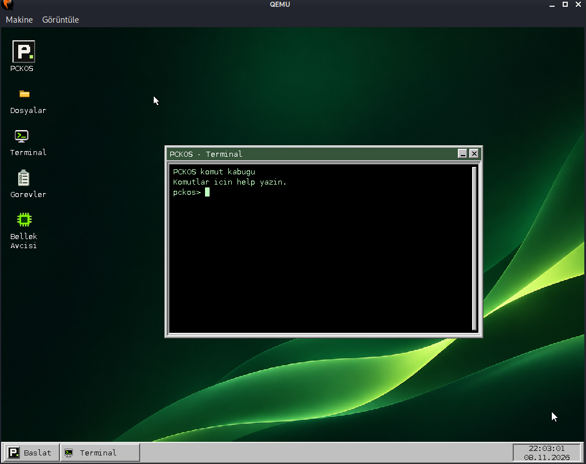
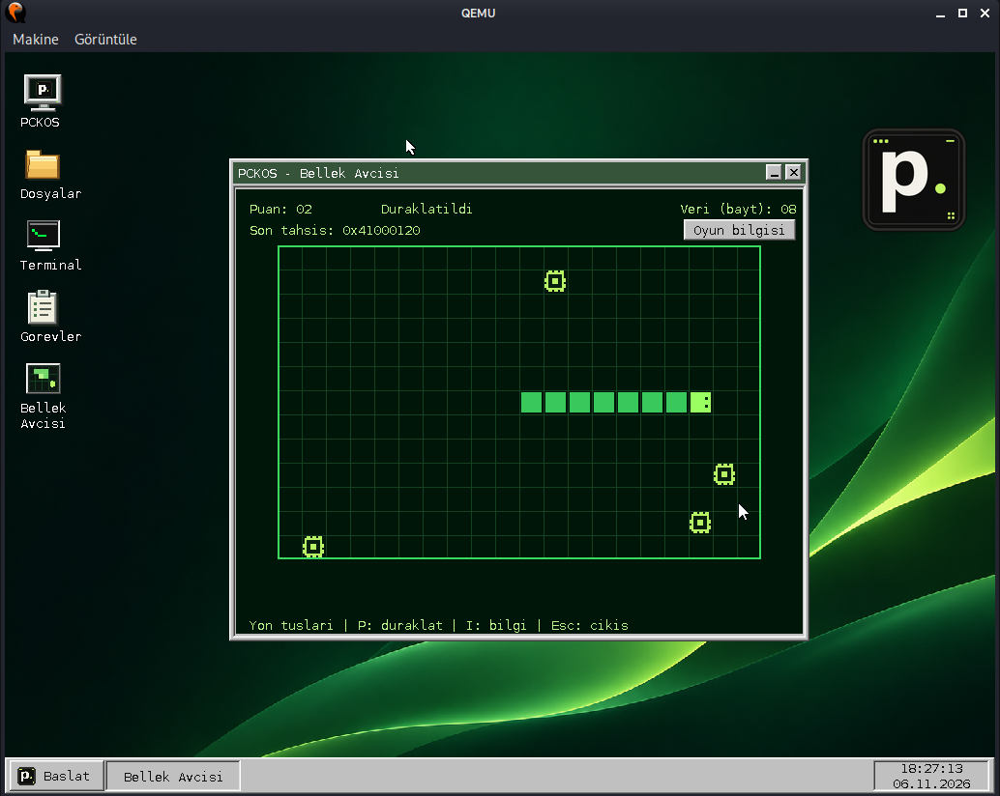
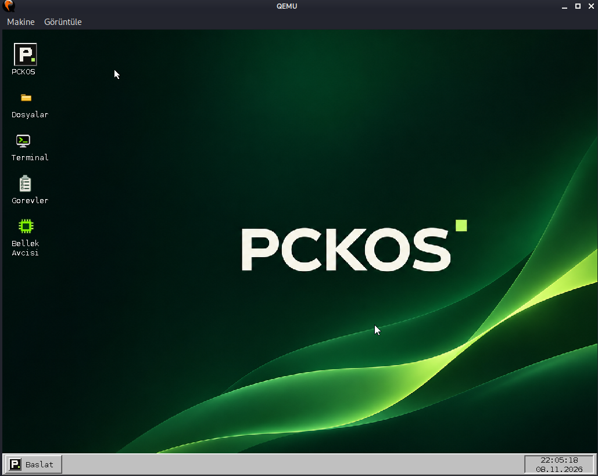
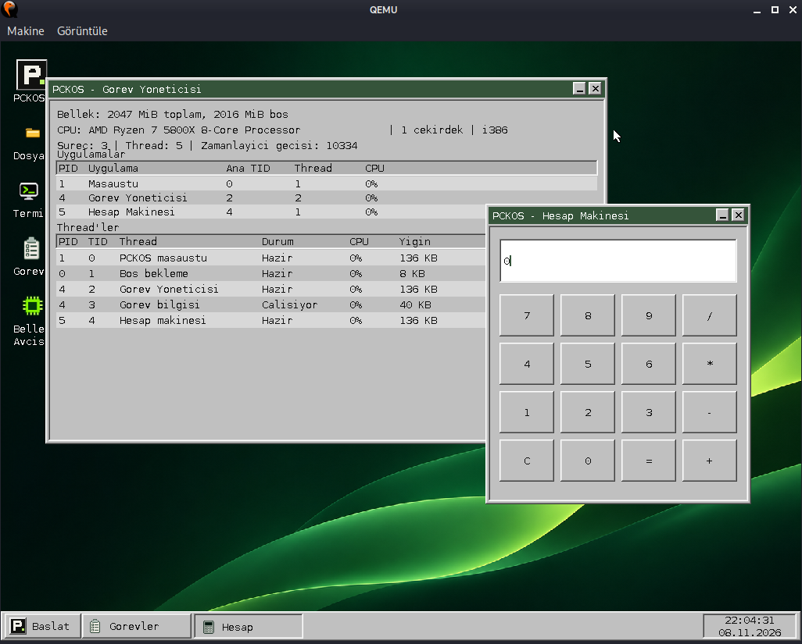

# PCKOS

[Türkçe](README.md) | [English](README.en.md)

**PCKOS**, bir sistem programcısı olarak hobi amacıyla sıfırdan geliştirmeye başladığım bir işletim sistemi çekirdeği projesidir.
Yaklaşık yedi yıl önce kendi işletim sistemi çekirdeğimi yazmaya başladım.
Projeye hiçbir zaman tam zamanlı olarak odaklanma fırsatım olmadı. Son iki yıldır da geliştirme sürecinede eskiye nazaran  ara vermiş durumdayım.
Artık PCKOS'u açık kaynak olarak paylaşmaya karar verdim. Amacım, projeye ilgi duyan insanlarla bir topluluk oluşturmak ve kaldığımız yerden devam etmek. :)

Daha fazla bilgi için blog: [PCKOS blog yazım](https://pckblog.com/pckos.html)

PCKOS'un güncel derlemesini denemek için kullandığınız sanallaştırma aracına göre gerekli dosyaları indirin:

- **QEMU:** [PCKOS ISO](https://raw.githubusercontent.com/alipicakcii/pckos/main/downloads/pckos.iso) ve [PCKFS disk imajı (IMG)](https://raw.githubusercontent.com/alipicakcii/pckos/main/downloads/pckfs.img)
- **VirtualBox:** [PCKOS ISO](https://raw.githubusercontent.com/alipicakcii/pckos/main/downloads/pckos.iso) ve [PCKFS disk imajı (VDI)](https://raw.githubusercontent.com/alipicakcii/pckos/main/downloads/pckfs-vbox.vdi)
- [SHA-256 doğrulama değerleri](https://raw.githubusercontent.com/alipicakcii/pckos/main/downloads/SHA256SUMS)

VDI dosyası sorun çıkarırsa yeniden oluşturmak için `VirtualBox'ta çalıştırma` bölümüne bakın.

## QEMU'da çalıştırma

`pckos.iso` ve `pckfs.img` dosyalarını indirdikten sonra bu iki dosyayı aynı dizine koyup şu komutla başlatın:

```sh
qemu-system-i386 -m 2G \
  -cdrom pckos.iso \
  -drive file=pckfs.img,format=raw,if=ide,index=0,media=disk
```

ISO çekirdeği başlatır; `pckfs.img` PCKOS kök dosya sistemidir. İkisi de gereklidir.

## VirtualBox'ta çalıştırma

`pckos.iso` ve `pckfs-vbox.vdi` dosyalarını yukarıdaki bağlantılardan indirin. Hazır VDI dosyasını doğrudan VirtualBox’a ekleyebilirsiniz; dönüştürme gerekmez.

İsterseniz kendi VDI dosyanızı yeniden oluşturmak için `pckfs.img` dosyasını şu komutla dönüştürebilirsiniz:

```sh
VBoxManage convertfromraw pckfs.img pckfs-vbox.vdi --format VDI
```

Kaynak koddan imajları hazırlıyorsaınız proje dizininde aşağıdaki komutları çalıştırın:

```sh
./iso.sh
./share.sh
./vbox.sh
```

Bu komutlarda ISO'yu ve PCKFS disk imajını üretir; `vbox.sh`, `pckfs.img` dosyasını VirtualBox'ın kullanacağı `pckfs-vbox.vdi` biçimine dönüştürür.

İki yöntemden hangisiyle hazırlanırsa hazırlansın aşağıdakı adımları izleyelerek VirtualBox'ta PCKOS'u çalıştırabilirsiniz:

VirtualBox'ta yeni bir **Linux / Other Linux (32-bit)** sanal makinesi oluşturun. Belleği ihtiyacınıza göre ayarlayın. Grafik denetleyicisini **VBoxVGA** seçin ve 3D hızlandırmayı kapalı tutun. Boş bir sabit disk oluşturmayın. Depolama ayarlarında `pckos.iso` dosyasını optik sürücüye, `pckfs-vbox.vdi` dosyasını IDE **Primary Master** olarak ekleyin. Açılış sırasını optik sürücüden başlatacak şekilde ayarlayın. ISO sistemi başlatır; VDI kök dosya sistemini sağlar.


## PCKOS'un şu anki özellikleri

PCKOS şu an minimal ve geliştirme aşamasında olan bir sistemdir. Mevcut çekirdeğin başlıca yetenekleri:

- i386 üzerinde açılma, bellek sayfalama ve çekirdek/kullanıcı modu ayrımı.
- Sistem çağrıları üzerinden çekirdek hizmetlerine erişen kullanıcı uygulamaları.
- Tek çekirdekte çalışan, Round Robin zamanlamalı thread'ler ve ayrı adres alanları olan process'ler.
- Framebuffer tabanlı masaüstü; klavye, fare, pencereler ve görev çubuğu.
- Ortak `Window`, `Widget`, `Button` ve `ClickListener` kullanıcı arayüzü API'si; uygulama simgeleri masaüstü, Başlat menüsü ve görev çubuğunda PNG olarak gösterilir.
- PCKFS kök dosya sistemi ve IDE ATA PIO disk sürücüsü. Kullanıcı uygulamaları şu an dosyaları okuyabilir; genel dosya yazma desteği henüz yoktur.
- Masaüstünden açılan Terminal, Dosyalar, Görev Yöneticisi, Hesap Makinesi ve salt okunur Not Defteri.
- RTC'den tarih/saat okuma; Görev Yöneticisi'nde bellek, işlemci ve thread bilgileri.

## Katkı ve hata bildirimi

Yapay zekâ kullanımına karşı değilim; projeye yapılacak katkılarda yapay zekâ araçlarından yararlanılabilir. Tek beklentim, katkıyı gönderen kişinin yaptığı değişiklikleri anlaması ve açıklayabilmesidir.


## Lisans

Başka bir lisans bildirimi bulunmayan PCKOS kodu GNU Genel Kamu Lisansı'nın 3. sürümü veya (tercihinize bağlı olarak) daha sonraki sürümleri altında lisanslanır. Tam metin için [`LICENSE`](LICENSE) dosyasına bakın. Üçüncü taraf varlıkların kendi lisans bildirimleri geçerlidir.

## Ekran görüntüleri

### Terminal



### Bellek Avcısı



Bellek Avcısı oyununda her yem alındığında kullanıcı heap'inden bir `uint32_t` (4 bayt) ayrılır. Pencerede tahsis adresi ve ayrılan oyun verisinin toplam boyutu gösterilir. Son tahsis adresi, ayrılan son 4 baytlık bloğun başlangıç adresidir. Oyun kapanırken tahsisler `delete` ile serbest bırakılır. Gerçek bir Bellek Avcısı! 🙂

### Masaüstü



### Görev Yöneticisi ve Hesap Makinesi



## Geliştirme ortamı

PCKOS'u Kali Linux üzerinde geliştiriyorum. C++ kodunu, GCC 13.1.0 kaynak kodundan derlediğim GNU `i686-elf-g++` çapraz derleyicisiyle; assembly kodunu NASM 3.01 ile derliyorum. Kali Linux kullanılan geliştirme ana makinesidir; PCKOS'un hedef mimarisi i386'dır.

# Teknik dokümantasyon

Bu belge PCKOS'un **mevcut çalışan kodunu** anlatır. Yeni bir özellik eklerken önce “Nerede ne var?” tablosuna bakın; sonraki bölümlerde açılış, PCKFS, sistem çağrıları, process/thread ve yeni uygulama örneği bulunur. Komutlar proje kök dizininde çalıştırılır.

## 1. Açılış: ilk komuttan masaüstüne

```text
QEMU/BIOS → GRUB → Multiboot _start → kernel_main
          → GDT/IDT + bellek + sürücüler + PCKFS + PIT
          → kullanıcı adres alanı → Ring 3 masaüstü
          → PCKFS'ten ayrı uygulama süreçleri
```

1. `./run.sh`, `pckos.iso` dosyasını CD-ROM, `pckfs.img` dosyasını IDE disk olarak QEMU'ya bağlar. `iso.sh` tarafından yazılan `isodir/boot/grub/grub.cfg`, GRUB'a `pckos.bin` çekirdeğini ve 1024×768×32 grafik modunu söyler.
2. `kernel/arch/i386/boot.asm` içindeki Multiboot başlığı GRUB tarafından okunur. `_start` ilk 16 KiB çekirdek yığınını kurar, Multiboot bilgi adresini `kernel_main()` fonksiyonuna verir. `kernel/arch/i386/linker.ld` çekirdeği 1 MiB adresine bağlar.
3. `kernel/kernel.cpp` kesmeleri kapatır; işlemci tablolarını kurar, sayfalamayı başlatır. `_init()`, çekirdek heap'i hazır olduktan sonra global C++ kurucularını çalıştırır.
4. Klavye, fare, framebuffer, ATA PIO disk ve PCKFS başlatılır. `_kprintf` ile açılış bilgileri çekirdek konsol günlüğüne yazılır. PIT 100 Hz ayarlanır. Framebuffer hazır olduğunda açılış günlüğü ekranda gösterilir; CPU üreticisi/modeli, Multiboot bilgileri, GDT/IDT/TSS, CR3, fiziksel sayfa sayıları, görüntü boyutları, disk/PCKFS durumu ve RTC tarihi yazılır. Masaüstüne geçmeden önce syscall, kullanıcı heap/yığın ve zamanlayıcı bilgileri gösterilir. Masaüstünde ESC tuşuna bastığınızda açılış mesajları ve sonraki çekirdek çıktıları sistem konsolunda görünür. Günlüğü `dmesg` ile de okuyabilirsiniz.
5. `kernel/user_mode.cpp` kullanıcı sayfalarını, kullanıcı yığınını ve sistem çağrılarını hazırlar; `kernel/thread.cpp` zamanlayıcıyı kurar. `user_mode_run_desktop()` masaüstü imajını `0x40000000` adresine yükler. `kernel/arch/i386/user_mode.asm` içindeki `iret` Ring 3'e geçer.
6. Masaüstü `kernel/user/apps/desktop.cpp` içindeki `_start` ile çalışır. Dosyalar, Terminal, Görevler, Hesap Makinesi veya Not Defteri açıldığında `process_spawn()` çağrılır; çekirdek `/apps/*.bin` imajını PCKFS'ten yükler, yeni PID, adres alanı ve ana thread oluşturur.

### Masaüstü ve uygulamaların yüklenmesi

Masaüstü programı `kernel/arch/i386/user_desktop.asm` içindeki `incbin` yönergesiyle çekirdek imajına eklenir ve açılışta belleğe alınır. Diğer uygulamalar çekirdeğe eklenmez; başlatıldıklarında PCKFS diskindeki `/apps/*.bin` dosyalarından yüklenir. Her ikisi de Ring 3'te çalışır; sürücüler ve sistem çağrısı işleyicileri Ring 0'da çalışır.

## 2. Nerede ne var?

| Konum | Burada ne yapılır? |
| --- | --- |
| `kernel/arch/i386/` | Multiboot girişi, GDT/IDT, kesme ve Ring 3 geçişi, bağlantı betikleri |
| `kernel/kernel.cpp` | Çekirdek başlatma sırası |
| `kernel/mem/` | Sayfalama, fiziksel bellek, çekirdek heap'i |
| `kernel/interrupts/`, `kernel/thread.cpp` | IRQ/PIT, Round Robin zamanlama, PID/TID tabloları |
| `kernel/device/ata_pio.cpp` | IDE diskten sektör okuma/yazma |
| `kernel/device/rtc.cpp` | CMOS RTC'den gerçek tarih ve saati okuma |
| `kernel/fs/pckfs.cpp` | PCKFS bağlama, yol çözme, dizin ve dosya okuma |
| `kernel/user_mode.cpp` | Kullanıcı adres alanları, program yükleme, process ve kullanıcı thread'i oluşturma |
| `kernel/syscall.cpp` | `int 0x80` giriş kontrolü ve çağrı yönlendirmesi |
| `kernel/syscalls/` | Konuya göre ayrılmış syscall işleyicileri ve kullanıcı belleği doğrulaması |
| `kernel/include/user/syscall.hh` | Kullanıcı alanındaki `int 0x80` geçiş kodu |
| `kernel/include/abi/` | Sabit syscall numaraları ve çekirdek/kullanıcı alanının ortak veri yapıları |
| `kernel/include/user/` | Thread, süreç, dosya, grafik ve diğer kullanıcı API başlıkları |
| `kernel/include/user/gui.hh`, `kernel/user/gui/graphics.cpp` | Ring 3 ortak çizim API'si |
| `kernel/include/user/lib/window.hh`, `kernel/user/lib/window.cpp` | Uygulama penceresi, başlık çubuğu, sürükleme, küçültme ve kapatma |
| `kernel/include/user/lib/widgets.hh`, `kernel/user/lib/widgets.cpp` | Yeniden kullanılabilir widget, buton ve `ClickListener` |
| `kernel/device/video/frame_buffer.cpp` | Ekran belleği ve pencerelerin katmanlarla birleştirilmesi |
| `kernel/user/apps/desktop.cpp` | Masaüstü, simgeler, Başlat, görev çubuğu ve uygulama başlatma |
| `kernel/user/apps/*_process.cpp` | Her uygulamanın `_start` ve olay döngüsü |
| `kernel/user/apps/terminal.cpp`, `file_manager.cpp`, `task_manager.cpp` | Uygulama içeriği/iş mantığı |
| `assets/app-icons/` | Kaynak PNG uygulama simgeleri; `share.sh` bunları PCKFS içindeki `/system/icons/` dizinine kopyalar |
| `tools/mkpckfs.py`, `host-share/` | Disk imajı üretimi ve host'tan aktarılacak dosyalar |

Çekirdek heap'i büyürken yeni sayfalar önce ana çekirdek sayfa dizinine (`KERN_PAGE_DIRECTORY`) eşlenir. `Vmm::sync_all_from_kernel()` bu eşlemeleri açık kullanıcı süreçlerine yayar. Sayfa hatasında çekirdek konsol günlüğündeki `[PageFault]` satırı hatalı adresi (`CR2`), komut adresini (`EIP`), hata kodunu ve etkin sayfa dizinini (`CR3`) gösterir.

## 3. Derleme ve çalışma

Gereken araçlar: `i686-elf-g++`, `i686-elf-objcopy`, `nasm`, `make`, `grub-mkrescue`, `python3`, `qemu-system-i386`. Ortak ayarlar `config.sh` ve `kernel/Makefile` içindedir.

| Komut | Etkisi |
| --- | --- |
| `./build.sh` | Çekirdeği/uygulamaları derler, çekirdeği `sysroot/boot/` altına kurar. |
| `./iso.sh` | `build.sh` çalıştırır, `pckos.iso` üretir. |
| `./share.sh` | `build.sh` çalıştırır; `host-share/`, sistem uygulamaları ve logodan `pckfs.img` üretir. |
| `./run.sh` | Temizler, ISO ve diski yeniden üretir, QEMU'yu açar. |
| `./vbox.sh` | Mevcut `pckfs.img` dosyasını `pckfs-vbox.vdi` biçimine çevirir. Önce güncel imajı `./run.sh` veya `./share.sh` ile üretin. |
| `./clean.sh` | Derleme ve imaj çıktılarını temizler; `host-share/` korunur. |

`sysroot/` ve `isodir/` sadece hazırlık alanlarıdır. Çalışan sistemin kökü `pckfs.img` içindeki `/` dizinidir. `initrd` kullanılmaz. `.elf` bağlantı çıktısıdır; çalışan yükleyicinin aldığı imaj `objcopy` ile üretilmiş **düz `.bin`** dosyasıdır. `run.sh` erişim varsa KVM, yoksa TCG kullanır. Seri port kapalıdır. Çekirdek çıktılarını ESC konsolunda veya `dmesg` ile görebilirsiniz.

`vbox.sh` mevcut `pckfs-vbox.vdi` çıktısını kaldırıp `convertfromraw` ile tekrar üretir. Dönüşümde sanal makineye kayıtlı sabit disk UUID'sini kullanır; böylece VirtualBox'ın disk kaydı bozulmaz. ISO'yu, çekirdeği veya VirtualBox makine ayarlarını değiştirmez. Yeniden üretim sırasında VirtualBox makinesi kapalı olsun.

## 4. PCKFS v1: basit teknik açıklama

`tools/mkpckfs.py` varsayılan olarak 32 MiB ham disk imajı üretir. `share.sh` önce `host-share/` ağacını `sysroot/pckfs-source/` içine kopyalar; derlenmiş uygulamaları `/apps/` altına, `assets/app-icons/` PNG dosyalarını `/system/icons/` altına ekler. `assets/logo.bmp` otomatik olarak `/system/logo.bmp` olur. Varsayılan dizinler `/boot`, `/dev`, `/etc`, `/home`, `/mnt`, `/tmp`, `/var`; `/apps` sistem uygulamalarından oluşur. Bunlar şu an adlandırılmış dizinlerdir; `/dev` için aygıt düğümü semantiği gibi Unix özellikleri yoktur.

Diskin fiziksel düzeni:

```text
LBA 0: süperblok (512 bayt, magic "PCKFS1\0\0", sürüm 1)
LBA 1...: inode tablosu (256 kayıt × 64 bayt)
sonra: blok zinciri tablosu (her veri bloğu için 32 bit sonraki blok numarası)
sonra: veri bölgesi (blok başına 4096 bayt = 8 sektör)
```

Süperblok toplam sektör, inode/FAT/veri başlangıçlarını ve kök inode numarasını taşır. Her inode 48 bayt ad, dosya boyutu, ilk veri bloğu, üst dizin inode'u, tür ve kullanım bayrağı içerir. Tür `1` dosya, `2` dizindir; kök inode `0`'dır. FAT benzeri zincirde `0xFFFFFFFF` son blok işaretidir. Veri bloğu numarası **1'den** başlar; blok 1'in ilk sektörü `data_start_sector` konumudur. Dizinler, kendi içerikleri için ayrı blok taşımaz: çocuklar inode tablosunda `parent` alanı karşılaştırılarak bulunur. Dosya/dizin adı en çok 47 UTF-8 bayttır. Sembolik bağlantı yoktur.

Açılışta `AtaPioDisk::initialize()` IDE diski bulur. `pckfs_mount()` süperblok, boyutlar, inode'lar ve FAT'i doğrular. `pckfs_find()` `/a/b` yolunu bileşenlere böler; `pckfs_get_child()` dizini listeler; `pckfs_read_file_range()` blok zincirini izleyip sektörleri okur. Üretici `tools/mkpckfs.py`, okuyucu `kernel/fs/pckfs.cpp` ve kullanıcıya sunulan dosya çağrıları `kernel/syscalls/filesystem.cpp` içindedir. **Disk biçimini değiştirirken bu üçünü birlikte güncelleyin.** Sürüm veya inode yerleşimi değişirse eski imajın bağlanmasını engellemek için doğrulamayı da değiştirin.

PCKFS v1 şu anda kullanıcı programları için **salt okunur**. ATA sürücüsünde sektör yazma işlevi bulunsa da PCKFS'te genel dosya oluşturma/yazma/silme ve bunlar için syscall henüz yoktur. Host'tan dosya aktarmak için:

```sh
mkdir -p host-share/home/pck
cp ornek.txt host-share/home/pck/ornek.txt
./run.sh
```

Dosya PCKOS'ta `/home/pck/ornek.txt` olur. Dosyalar uygulamasında görünür; Terminal'de `cat /home/pck/ornek.txt` ile okunabilir. `run.sh` diski her seferinde yeniden ürettiği için kaynak dosyayı `host-share/` içinde tutun.

Kullanıcı programında okuma örneği:

```cpp
#include <user/filesystem.hh>
#include <user/io.hh>

char buffer[128];
const int32_t fd = user::open("/home/pck/ornek.txt"); // flags=0, okuma
if (fd >= 0) {
    const int32_t count = user::read(fd, buffer, sizeof(buffer));
    if (count > 0)
        user::write(user::stdout_descriptor, buffer,
                    static_cast<uint32_t>(count));
    user::close(fd);
}
```

`run` ile başlatılan uygulamalarda `stdout` ve `stderr` çağıran terminale gider; ayrıntılar aşağıdadır. Dizin için `root_inode()` ve `read_directory(inode, index, &entry)` kullanın: dönüş `1` öğe, `0` liste sonu, negatif değer hatadır. `DirectoryEntry::type == user::directory_type` dizini gösterir.

## 5. SDK ve sistem çağrıları

Kullanıcı API'si `kernel/include/user/` altında konuya göre ayrılmıştır:

| Başlık | İşlev |
| --- | --- |
| `user/thread.hh` | Thread oluşturma, bekleme ve thread bilgileri |
| `user/process.hh` | Süreç başlatma, sonlandırma ve pencere odağı |
| `user/filesystem.hh` | Dosya okuma ve dizin listeleme |
| `user/io.hh` | Standart akışlar ve terminal bağlantısı |
| `user/input.hh` | Klavye ve fare olayları |
| `user/graphics.hh` | Alt düzey çizim ve pencere çağrıları |
| `user/heap.hh` | Kullanıcı belleği ayırma ve serbest bırakma |
| `user/system.hh` | Sistem bilgileri, saat ve çekirdek günlüğü |
| `user/audio.hh` | PC speaker |

`user/syscall.hh` yalnızca `int 0x80` geçiş kodunu ve çağrı numaralarına erişimi sağlar. `ThreadInfo` gibi ortak veri yapıları `kernel/include/abi/` altında tek kez tanımlanır; ilgili çekirdek ve kullanıcı başlıkları bu tanımı kullanır.

Grafik yardımcıları `kernel/include/user/gui.hh` ve `kernel/user/gui/graphics.cpp` içindedir. Ortak pencere ve widget API'si `kernel/include/user/lib/` altında, uygulamaları ise `kernel/user/lib/window.cpp` ve `widgets.cpp` içindedir. `Window` pencere kaydını, çerçeveyi, başlık çubuğu düğmelerini, sürüklemeyi, küçültmeyi ve kapatmayı yönetir. `Button`, `Label` ve `TextInputWidget` oluşturulduklarında ebeveyn pencereye eklenir. `Window::draw()` pencere içeriği alanındaki widget'ları çizer; `Window::handle_mouse()` tıklamaları widget'lara yollar. `Button` tıklamaları `ClickListener` callback'ini çağırır; `TextInputWidget` tıklanan konumda yazı imlecini ayarlar. Makefile bu kütüphane kaynaklarını kullanıcı uygulamalarına bağlar. `kernel/include/user/lib/memory.hh` temel bellek/metin işlevlerini, `kernel/include/user/lib/new.hh` ise kullanıcı heap'i üzerinden `new`/`delete` işleçlerini sağlar. Bu, başlangıç düzeyinde küçük bir çalışma kütüphanesidir; tam C/C++ standart kütüphanesi veya STL değildir.

### Pencere ve buton widget'ı

Her uygulama kendi `Window` nesnesini oluşturur. Pencere API'si kaydetme, başlık çubuğunu çizme, sürükleme, küçültme ve kapatma işlemlerini üstlenir. Uygulama içeriğini pencerenin `content_x()`, `content_y()`, `content_width()` ve `content_height()` değerlerine göre yerleştirir. Pencereye bağlı widget'lar içerik alanına göre yerel koordinat kullanır. Her çizim karesinde `Window::draw()` çağrısı pencereyi ve ekli widget'ları çizer. Fare olayını `Window::handle_mouse()` metoduna verin; pencere düğmeleri ve ekli widget'lar olayı kendileri işler.

`ClickListener`, yakalamasız C++ lambda yerine callback ve bağlam işaretçisi alır. Böylece uygulama durumunu callback'e iletebilirsiniz:

```cpp
#include <user/lib/widgets.hh>
#include <user/lib/window.hh>

void on_button_click(void *context, uint32_t id)
{
    auto *click_count = static_cast<uint32_t *>(context);
    if (id == 1)
        ++*click_count;
}

uint32_t clicks = 0;
user::gui::Window window(120, 90, 420, 280, "PCKOS - Ornek");
user::gui::ClickListener listener(on_button_click, &clicks);
user::gui::Button button(window, 1, 16, 16, 140, 36, "Tikla", &listener);

user::gui::begin_frame();
window.draw();
user::gui::end_frame();

window.handle_mouse(mouse_x, mouse_y, mouse_buttons, pressed,
                    screen_width, usable_height);
```

`Button` oluşturucusundaki konum pencerenin içerik alanına göredir. Hesap Makinesi ve birim dönüştürücü ortak pencere/buton API'sini kullanır; diğer pencereli uygulamalar da çerçeve, taşıma ve başlık düğmelerini `Window` üzerinden yönetir.

### Standart giriş, çıktı ve hata akışları

Örneğin `/apps/newapp.bin` olarak bir PCKOS için uygulama yazdınız; `run /apps/newapp.bin` uygulamayı ayrı süreçte başlatır ve terminal bağlantısını aktarır. `stdin` (0) terminalden giriş alır; `stdout` (1) normal çıktı, `stderr` (2) hata çıktısıdır. İki çıktı akışı aynı terminalde çağrı sırasıyla gösterilir; uygulama çıktısı bu durumda çekirdek günlüğüne eklenmez. Alt süreçler de terminal bağlantısını devralır. Terminal bağlantısı olmayan uygulamalarda çıktı sistem konsol günlüğüne gider. Seri porta yazılmaz.

Terminal, `run` ile başlattığınız süreç bitene kadar yeni kabuk komutu çalıştırmaz; Enter ile gönderdiğiniz satırları uygulamanın `stdin` kuyruğuna koyar. Boş girişte Ctrl+D EOF gönderir; yazılmış metin varsa önce o metni gönderir. Program bitince `pckos>` geri gelir. Grafik uygulaması pencere kaydettiğinde odağı kendi penceresine alır. Simge durumundaki terminal de çıktıları toplamaya devam eder.

```cpp
#include <user/io.hh>
#include <user/process.hh>
#include <user/lib/io.hh>

extern "C" [[noreturn]] __attribute__((section(".text._start"))) void _start()
{
    print("Merhaba %s! Deger: %d\n", "PCKOS", 42);
    eprint("Ornek hata kodu: %d\n", -1);
    print("Bir satir yazin ve Enter'a basin:\n");
    char input[128];
    const int32_t count = user::io::read(input, sizeof(input));
    if (count > 0)
        user::io::write_all(user::stdout_descriptor, input, count);
    user::exit(count < 0 ? 1 : 0);
}
```

`<user/lib/io.hh>` başlığını ekleyip doğrudan `print("Deger: %d\n", value)` kullanın. `print` stdout'a, `eprint` stderr'e yazar; `fprint(fd, format, ...)` ile bu iki tanıtıcıdan birini seçebilirsiniz. İşlevlere `user::io` içinden de erişebilirsiniz. Dönüş değeri yazılan bayt sayısı veya negatif hata kodudur. Uygulama `kernel/user/lib/io.cpp` içindedir; elle derlediğiniz uygulamanın bağlantısına `kernel/user/lib/io.user.o` ekleyin. Projenin Makefile'ı bunu otomatik bağlar.

Desteklenen biçimler: `%s`, `%c`, `%d`, `%i`, `%u`, `%x`, `%X`, `%o`, `%p`, `%%`; alan genişliği, `-`, `0`, `+`, boşluk ve `#` bayrakları; `%.3s` veya `%08x` gibi hassasiyet/genişlik; `*` ile genişlik/hassasiyet ve tam sayılar için `h`, `hh`, `l`, `z` değiştiricileri. Genişlik ve hassasiyet en çok 4096 olabilir. Ondalıklı sayı biçimleri, `ll` ve `%n` henüz desteklenmez; desteklenmeyen biçim `-22` döndürür. İçinde yüzde işareti bulunan hazır metni `print("%s", text)` ile yazın.

`user::io::write_all` ham baytları yazar; `user::io::read` giriş hazır olana kadar thread'i uyutarak bekler, EOF için `0`, hata için negatif değer döndürür. Kitaplık minimaldir; tam libc veya iostream desteği değildir.

Masaüstü, yeni çekirdek mesajlarını `read_kernel_log(buffer, capacity, &cursor)` (syscall 47) ile takip eder. Okuma konumunu sıfırdan başlatıp çağrılar arasında koruyun. Çekirdek günlüğü 4096 baytlık bir halkadır; okuyucu geride kalırsa kalan en eski bayttan devam eder. ESC konsolu aynı günlüğü tekrar tekrar eklemeden yeni mesajları gösterir.

Alt düzey `user::write(fd, buffer, length)` bir çağrıda en çok 4096 bayt kabul eder. Terminalin ortak çıktı kuyruğu 8192 bayttır; kısa yazma dönebilir, tamamen doluysa `-11` (EAGAIN) döner. `write_all` bunları tekrar deneyerek tamamlar. Terminal kapanmışsa yazma `-32` (EPIPE) döner; sinyal üretilmez. Süreç başına giriş kuyruğu 512 bayttır; bağlı `stdin` boşken `user::read` `-11`, EOF sonrasında `0` döner. Çıktılar ayrı `write` çağrıları arasında satır devamlılığını korur; ANSI kaçış dizileri henüz yorumlanmaz.

Terminal ön yüzü için `terminal_attach()` (44) çağıran süreci terminal sahibi yapar; `terminal_read(buffer, length)` (45) sıradaki çıktıyı tüketir; `terminal_send(pid, buffer, length)` (46) yalnızca bu terminale bağlı sürece giriş yollar. Sıfır uzunluk EOF anlamına gelir. Normal uygulamalar bu çağrıları kullanmaz; `read`/`write` veya `user::io` yardımcılarını kullanın. Dosyaya yönlendirme (`>`), pipe (`|`), `dup2`, sinyaller ve tam iş denetimi henüz yoktur.

`user::call()`, `int 0x80` çalıştırır. `EAX` çağrı numarası, `EBX/ECX/EDX/ESI/EDI` en çok beş argüman, sonuç yine `EAX` içindedir. `kernel/syscall.cpp` çağrıyı ilgili `kernel/syscalls/` işleyicisine yönlendirir; işleyici kullanıcı işaretçilerini ve uzunlukları doğrular. Hatalar negatif sayı olarak döner. Kodda sayıları elle kullanmak yerine sarmalayıcı fonksiyonları çağırın.

| Alan | Önemli API'ler |
| --- | --- |
| Dosya | `open`, `read`, `close`, `root_inode`, `read_directory` |
| Günlük/giriş | `read`, `write`, `<user/lib/io.hh>`, `terminal_attach`, `terminal_read`, `terminal_send`, `get_kernel_log`, `read_kernel_log`, `wait_event` |
| Process | `process_spawn`, `process_count`, `process_get_info`, `process_focus`, `process_minimize`, `exit` |
| Thread | `thread_create`, `thread_id`, `thread_sleep`, `thread_yield`, `thread_exit`, `thread_get_info` |
| Bellek | `heap_alloc`, `heap_free`, `<user/lib/new.hh>` ile `new`/`delete`, `<user/lib/memory.hh>` ile `memcpy`, `memmove`, `memset`, `memcmp`, `strlen`, `strcmp`, `strncmp`, `strcpy`, `strncpy` |
| Sistem | `get_ticks`, `get_datetime`, `get_heap_usage`, `get_system_info` |
| Grafik | `graphics_get_info`, `graphics_register_window`, `graphics_begin_frame`, `graphics_end_frame`, `graphics_rect`, `graphics_text`, `graphics_bitmap`, `graphics_push_clip`, `graphics_pop_clip` |

`wait_event(&event, ticks)`: `type=1` klavye (`value0` karakter), `type=2` fare (`value0` X farkı, `value1` Y farkı), `type=3` zaman aşımıdır. `buttons & 1` sol tuş; `buttons & 0x100` yeni basma kenarıdır. 100 PIT tik'i yaklaşık bir saniyedir. Çizim ekran koordinatlarıyla yapılır. Pencereli uygulamalar `Window` oluşturucusuyla pencereyi kaydeder; kareyi `user::gui::begin_frame()` ve `end_frame()` arasında çizer, `Window::draw()` ile pencereyi gösterir ve fare olaylarını `Window::handle_mouse()` metoduna verir. Düşük seviyeli özel çizimler için `user::gui::fill`, `text`, `button`, `icon` ve `push_clip` yardımcıları kullanılabilir.

`get_datetime(&date)` RTC'deki yıl, ay, gün, saat, dakika ve saniyeyi `user::DateTime` yapısına doldurur. Görev çubuğundaki saat açılıştan beri geçen süreyi değil sanal makinenin RTC saatini gösterir; QEMU betiği RTC'yi host yerel saatiyle başlatır. Hesap Makinesi ve Not Defteri Başlat menüsünden açılır; ikisi de ayrı PID ve ana thread alır. Hesap Makinesi tam sayı işlemleri (`+`, `-`, `*`, `/`) yapar. Not Defteri, yol alanına yazılan herhangi bir PCKFS metin dosyasının ilk 8191 baytını **salt okunur** gösterir. Örneğin `host-share/home/notlar.txt` konursa yol `/home/notlar.txt` olur; dosya adının kodda özel bir anlamı yoktur.

```cpp
user::InputEvent event{};
if (user::wait_event(&event, 10) > 0 &&
    event.type == 1 && event.value0 == 0x1B)
    user::exit(0); // ESC
```

Yeni syscall eklerken: numarayı `kernel/include/abi/syscall.hh` içine, kullanıcı sarmalayıcısını ilgili `kernel/include/user/` başlığına ekleyin. İşleyiciyi ilgili `kernel/syscalls/` kaynak dosyasına, yönlendirmeyi `kernel/syscall.cpp` içine ekleyin. Kullanıcıdan gelen adresleri `is_user_range` ile denetleyin. Gerekiyorsa asıl çekirdek işlevini `kernel/` altında ilgili modülde uygulayın. Dönüş kodu ve sınırları burada belgeleyin.

**Kullanıcı uygulamalarında bellek ve temel yardımcılar**

`kernel/include/user/lib/memory.hh` başlığı `memcpy`, `memmove`, `memset`, `memcmp`, `strlen`, `strcmp`, `strncmp`, `strcpy` ve `strncpy` işlevlerini sunar. Bunlara `user::memory::copy`, `move`, `fill`, `compare`, `length` ve `equal` yardımcılarıyla da erişebilirsiniz. Uygulamanın bağlantısına `kernel/user/lib/memory.user.o` ekleyin.

`kernel/include/user/lib/new.hh` başlığı ve `kernel/user/lib/new.cpp` kullanıcı alanına `new`, `new[]`, `delete`, `delete[]`, placement new ve C++17 hizalı tahsis desteği sağlar. Uygulamanın bağlantısına `kernel/user/lib/new.user.o` ekleyin. Mevcut Makefile üç kullanıcı runtime nesnesini de yerleşik uygulamalar için otomatik bağlar. Çekirdeğin `kernel/mem/new.cpp` uygulaması çekirdek heap'ini kullanmaya devam eder.

Örnek:

```cpp
#include <user/lib/memory.hh>

char text[16];
user::memory::fill(text, 0, sizeof(text));
user::memory::copy(text, "PCKOS", 6);
if (user::memory::equal(text, "PCKOS")) {
    // Metinler eşleşti.
}
```

```cpp
#include <user/lib/new.hh>

int *value = new int(42);
delete value;

int *numbers = new (std::nothrow) int[100];
if (numbers != nullptr) {
    numbers[0] = 7;
    delete[] numbers;
}
```

Her süreçte `0x41000000–0x43000000` adres aralığında 32 MiB'a kadar heap vardır; fiziksel sayfalar ihtiyaç oldukça ayrılır. Aynı süreçteki thread'ler bu alanı paylaşır, farklı süreçlerin sayfa eşlemeleri ayrıdır. Aynı anda en çok 1024 tahsis tutulur. Varsayılan hizalama 16 bayttır; ikinin kuvveti olan hizalamalar en çok 1 MiB'a kadar kabul edilir. Küçük tahsisler sayfaları paylaşır; bir sayfadaki son tahsis silinince fiziksel sayfa geri verilir. Süreç kapanınca `delete` edilmemiş tahsisler de temizlenir.

`heap_alloc(size, alignment)` (syscall 42) ham bellek verir, başarısızlıkta `nullptr` döndürür; `heap_free(address)` (syscall 43) belleği geri verir. Tahsis kayıtları çekirdekte saklanır; yalnızca çağıran sürecin geçerli tahsis başlangıcı serbest bırakılabilir. İşlemler mevcut tek çekirdekli sistemde kesmeler kapalı sistem çağrısı içinde tamamlanır. Normal `new` bellek bulamazsa istisnalar kapalı olduğu için günlüğe hata yazıp çağıran süreci `-12` durumuyla sonlandırır. Hatayı uygulamada ele almak için `new (std::nothrow)` kullanın. `get_heap_usage()` hâlâ çekirdek heap kullanımını bildirir.


## 6. Process nasıl oluşturulur?

**Process**, ayrı PID ve sayfa tablosu/adres alanı olan programdır. Açılışta çekirdek masaüstü process'ini başlatır; diğerleri yalnızca açılınca oluşturulur. Kullanıcı programından:

```cpp
const int32_t pid = user::process_spawn("/apps/terminal.bin", "Terminal");
if (pid < 0) {
    const char message[] = "Baslatma hatasi\n";
    user::write(user::stderr_descriptor, message, sizeof(message) - 1);
}
```

`process_spawn` sonucu başarılıysa yeni PID'dir. Çağrı uygulamanın bitmesini beklemez. Çekirdekte akış: `kernel/syscalls/process.cpp` kullanıcı yolunu/adını kopyalar → `user_mode_spawn_process()` PCKFS'te dosyayı bulup düz ikiliyi okur → boş adres alanı ayırır ve kod/yığın sayfalarını eşler → `process_create()` PID verir → `thread_create_user()` ana TID'yi oluşturur → giriş odağı yeni process'e geçer. Bunlar sırasıyla `kernel/user_mode.cpp` ve `kernel/thread.cpp` içindedir. Programın `_start` fonksiyonu başlar; `user::exit(status)` veya ana thread'in bitmesi process'i sonlandırır. Kapanınca kaynakları ve pencere katmanı serbest bırakılır.

Süreçleri listeleme:

```cpp
for (uint32_t i = 0; i < user::process_count(); ++i) {
    user::ProcessInfo info{};
    if (user::process_get_info(i, &info) == 0) {
        // info.id, parent_id, main_thread_id, thread_count, cpu_ticks, name
    }
}
```

Bir process'i öne getirmek için `process_focus(pid)`, kendi penceresini küçültmek için `process_minimize()` vardır. Masaüstü uygulama türü başına tek PID izlediğinden aynı simge tekrar basılınca mevcut pencere öne gelir.

## 7. Thread nasıl oluşturulur?

**Thread**, aynı process'in PID'sini ve adres alanını paylaşır; ayrı TID, kullanıcı yığını ve çekirdek kesme yığını alır. Tek çekirdekli PCKOS'ta PIT 100 Hz ve Round Robin zamanlayıcı thread'ler arasında geçiş yapar. Aynı anda fiziksel olarak tek thread yürür; birden fazla thread sırayla CPU kullanır.

```cpp
#include <user/thread.hh>

void worker(void *argument)
{
    volatile uint32_t *counter =
        static_cast<volatile uint32_t *>(argument);
    for (;;) {
        ++*counter;
        user::thread_sleep(100); // yaklaşık 1 saniye
    }
}

volatile uint32_t counter = 0;
const int32_t tid = user::thread_create(worker, (void *)&counter, "Sayac");
if (tid < 0) {
    // Thread oluşturulamadı.
}
```

`thread_create` başarılıysa TID döndürür. Kernel uygun bir thread yeri ve yeni kullanıcı yığını ayırır, giriş fonksiyonu ile argümanı yığına koyar; `thread_start_trampoline` fonksiyon bitince `thread_exit` çağırır. Çalışan örnek: `kernel/user/apps/task_manager_process.cpp` içindeki `TaskManager::thread_entry`; ana thread pencereyi çizerken worker thread bilgileri toplar. Paylaşılan veriler için mevcut `kernel/include/user/apps/app_thread.hh` içindeki `SpinLock`/`LockGuard` örneğini inceleyin. Genel amaçlı `join`, mutex ve semaphore API'si henüz yoktur. Ana thread/process bitince diğer thread'ler de temizlenir.

## 8. Yeni uygulama yazma, derleme ve başlatma

Örnek dosya: `kernel/user/apps/newapp_process.cpp`. PCKOS'un yüklediği düz ikilinin giriş noktası `_start` olmalıdır:

```cpp
#include <user/graphics.hh>
#include <user/input.hh>
#include <user/process.hh>
#include <user/thread.hh>
#include <user/gui.hh>
#include <user/lib/window.hh>

extern "C" [[noreturn]]
__attribute__((section(".text._start"))) void _start()
{
    constexpr uint32_t width = 360;
    constexpr uint32_t height = 180;
    user::GraphicsInfo screen{};
    if (user::graphics_get_info(&screen) < 0 ||
        screen.width < 400 || screen.height < 300)
        user::exit(1);

    const uint32_t usable_height = screen.height - 48;
    user::gui::Window window((screen.width - width) / 2,
                             (usable_height - height) / 2,
                             width, height, "PCKOS - NewApp");
    if (!window.valid())
        user::exit(1);
    user::thread_set_name("NewApp");

    int32_t mouse_x = static_cast<int32_t>(screen.width / 2);
    int32_t mouse_y = static_cast<int32_t>(screen.height / 2);
    (void)user::graphics_get_cursor(&mouse_x, &mouse_y);
    user::graphics_cursor(mouse_x, mouse_y, true);
    uint32_t last_buttons = 0;

    for (;;) {
        if (user::process_is_minimized()) {
            last_buttons = 0;
            user::InputEvent ignored{};
            (void)user::wait_event(&ignored, 10);
            continue;
        }

        user::gui::begin_frame();
        window.draw();
        user::gui::text(window.content_x() + 16, window.content_y() + 24,
                        "Merhaba PCKOS!", user::gui::COLOR_TEXT);
        user::gui::end_frame();

        user::InputEvent event{};
        if (user::wait_event(&event, 10) <= 0 || event.type == 3)
            continue;
        if (event.type == 1) {
            if (event.value0 == 0x1B)
                user::exit(0);
        } else if (event.type == 2) {
            int32_t cursor_x = mouse_x;
            int32_t cursor_y = mouse_y;
            if (user::graphics_get_cursor(&cursor_x, &cursor_y) == 0) {
                mouse_x = cursor_x;
                mouse_y = cursor_y;
            }
            mouse_x += event.value0;
            mouse_y -= event.value1;
            if (mouse_x < 0) mouse_x = 0;
            if (mouse_y < 0) mouse_y = 0;
            if (mouse_x >= static_cast<int32_t>(screen.width))
                mouse_x = static_cast<int32_t>(screen.width) - 1;
            if (mouse_y >= static_cast<int32_t>(screen.height))
                mouse_y = static_cast<int32_t>(screen.height) - 1;
            user::graphics_cursor(mouse_x, mouse_y, true);

            const bool pressed = (event.buttons & 1U) != 0 &&
                ((last_buttons & 1U) == 0 || (event.buttons & 0x100U) != 0);
            (void)window.handle_mouse(mouse_x, mouse_y, event.buttons, pressed,
                                      screen.width, usable_height);
            last_buttons = event.buttons;
        }
    }
}
```

Yukarıdaki örneği `kernel/user/apps/newapp_process.cpp` olarak kaydedin. Aşağıda yeni uygulamayı adım adım derleyip PCKOS'ta çalıştırıyoruz. Bütün terminal komutlarını projenin kök dizininde, `build.sh` dosyasının bulunduğu yerde çalıştırın.

Bu örnekte uygulamayı elle derliyoruz. Mevcut Makefile yalnızca içinde tanımlı uygulamaları derler; yeni bir `.cpp` dosyası oluşturduğunuzda onu kendiliğinden derlemeye eklemez. Bu nedenle aşağıdaki adımları sırayla uygulayın.

**1. Grafik ve bellek yardımcılarını hazırlayın.**

```sh
./build.sh
```

Bu komut mevcut çekirdeği ve projeye kayıtlı uygulamaları derler. Aynı zamanda örneğimizin kullanacağı `kernel/user/gui/graphics.user.o`, `kernel/user/lib/window.user.o`, `kernel/user/lib/widgets.user.o`, `kernel/user/lib/new.user.o`, `kernel/user/lib/memory.user.o` ve `kernel/user/lib/io.user.o` dosyalarını üretir. Henüz yeni `newapp_process.cpp` dosyamızı derlemez; onu sonraki adımda derleyeceğiz.

**2. Uygulamanın C++ kodunu derleyin.**

```sh
i686-elf-g++ -m32 -ffreestanding -Wall -Wextra -fno-exceptions -fno-rtti \
  -fno-use-cxa-atexit -fno-pic -fno-pie -fno-stack-protector -fno-builtin \
  -fno-unwind-tables -fno-asynchronous-unwind-tables -mno-sse -mno-mmx \
  -msoft-float -Ikernel/include \
  -c kernel/user/apps/newapp_process.cpp -o kernel/user/apps/newapp_process.user.o
```

Girdi, yazdığınız `newapp_process.cpp` dosyasıdır. `-c` seçeneği yalnızca derleme yapar ve sonuç olarak `newapp_process.user.o` nesne dosyasını oluşturur. Bu dosya henüz tek başına çalıştırılabilir değildir; kullandığı grafik fonksiyonlarıyla bağlanması gerekir. `-Ikernel/include` SDK başlık dosyalarının yerini belirtir. Diğer bayraklar PCKOS kullanıcı uygulamalarının mevcut derleme ayarlarıdır.

**3. Nesne dosyasını grafik kitaplığıyla bağlayın.**

```sh
i686-elf-g++ -m32 -no-pie -nostdlib \
  -Wl,-T,kernel/user/apps/linker.ld -Wl,--build-id=none \
  -o kernel/user/apps/newapp_process.elf \
  kernel/user/lib/new.user.o kernel/user/lib/memory.user.o kernel/user/lib/io.user.o \
  kernel/user/lib/window.user.o kernel/user/lib/widgets.user.o \
  kernel/user/gui/graphics.user.o kernel/user/apps/newapp_process.user.o
```

Bu adım uygulama nesnesini grafik, bellek ve `new`/`delete` runtime nesneleriyle birleştirir. `linker.ld`, uygulamanın bellek yerleşimini ve `_start` girişini tanımlar. Sonuç `newapp_process.elf` dosyasıdır. Bu ELF, bağlantı ara çıktısıdır; mevcut PCKOS yükleyicisi düz ikili dosya bekler.

**4. ELF dosyasını PCKOS'un yükleyebileceği biçime çevirin.**

```sh
i686-elf-objcopy -O binary kernel/user/apps/newapp_process.elf \
  host-share/apps/newapp.bin
```

`objcopy -O binary`, ELF içindeki yüklenebilir içeriği düz ikili dosyaya dönüştürür. Sonuç `host-share/apps/newapp.bin` olur. `host-share`, host makinenizdeki dosyaların PCKFS'e aktarılması için kullanılan dizindir. `host-share/apps` proje içinde zaten bulunur.

**5. Uygulamayı PCKFS disk imajına aktarın.**

```sh
./share.sh
```

`share.sh`, önce `build.sh` komutunu çağırır, ardından `host-share` içeriğini ve yerleşik uygulamaları paketleyerek `pckfs.img` dosyasını yeniden üretir. Elle derlediğiniz `newapp.bin` dosyasını olduğu gibi alır; uygulamanın kaynak kodunu yeniden derlemez. Host üzerindeki `host-share/apps/newapp.bin`, PCKOS içinde `/apps/newapp.bin` olarak görünür.

Bu noktada uygulama derlenmiş ve disk imajına eklenmiştir. **Uygulamayı çekirdeğe linklemek gerekmez.**

**6. İlk deneme için uygulamayı başlatın.**

Proje kökünde `./run.sh` çalıştırın. Betik temiz derleme yapar, ISO ve PCKFS imajlarını yeniden üretir ve QEMU'yu açar. `host-share/apps/newapp.bin` temizleme sırasında korunup yeni disk imajına eklenir.

Masaüstündeki Terminal'i açıp **PCKOS terminaline** şu komutu yazın:

```text
run /apps/newapp.bin
```

Terminal bu dosyadan yeni bir process başlatır. Uygulamayı başlatmak için `desktop.cpp` dosyasını değiştirmeniz gerekmez.  Başka bir uygulamanın kodundan başlatmak için `user::process_spawn("/apps/newapp.bin", "NewApp")` kullanın.

**Uygulamanın kodunu değiştirdiğinizde:** 2, 3 ve 4. adımları tekrar çalıştırarak `host-share/apps/newapp.bin` dosyasını güncelleyin. Ardından `./run.sh` ile deneyin; bu betik 5. adımdaki paketlemeyi de kendisi yapar. Yalnızca disk imajını yenilemek isterseniz `./share.sh` çalıştırın. Temizleme sonrasında `graphics.user.o` bulunmuyorsa veya grafik kitaplığını değiştirdiyseniz önce 1. adımı da uygulayın.
